<div align="center">

# Livestream Style Video Skill

An Agent Skill (`SKILL.md` + reference playbooks + offline CLI tools) for Claude Code, Cursor, GitHub Copilot, and Codex to map any visual style or storyline into `9:16` livestream-perspective shorts, compile clean-plate video prompts, overlay mainstream room HUDs, and render `720p` HD previews locally.

[](SKILL.md)
[](#skill-workflow-and-quick-start)
[](LICENSE)

**[HD Video examples](#video-examples)** · [Cast rigs & live HUDs](#scene-boards-and-shot-pacing) · [Skill workflow & quick start](#skill-workflow-and-quick-start) · [Skill guide](SKILL.md)

**English** · [简体中文](README.zh-CN.md) · [繁體中文](docs/i18n/README.zh-TW.md) · [日本語](docs/i18n/README.ja.md) · [한국어](docs/i18n/README.ko.md) · [Español](docs/i18n/README.es.md) · [Français](docs/i18n/README.fr.md) · [Deutsch](docs/i18n/README.de.md) · [Português](docs/i18n/README.pt-BR.md) · [Русский](docs/i18n/README.ru.md)

</div>

<a name="examples-and-local-3d-previews"></a>

## Video examples

When invoked in an AI coding agent, this skill translates any visual style or story plot into a 15-second, four-shot vertical (`9:16`) livestream package across eight built-in charismatic casts (**Duolingo-inspired geometric owl & flat-3D cast**, **Open-Source Mascot IPs** `Linux Tux`, `CC0 Rust Ferris`, and `Godot Gear-Bot`, **Minecraft `8×8` Voxel Wuxia**, and **Sculpted-UGC Roblox R6**). Click any 256-color GIF below to play the full `720×1280` H.264 MP4 with synthesized live room audio:

| Duolingo Owl · Douyin | Flat-3D Cast · Night Market | Tux + Ferris · X Dev Cam | Godot Bot · Kuaishou `[AF-C]` |
| :---: | :---: | :---: | :---: |
| <a href="examples/duolingo-owl-streak-cam/assets/duolingo_owl_streak_cam.mp4">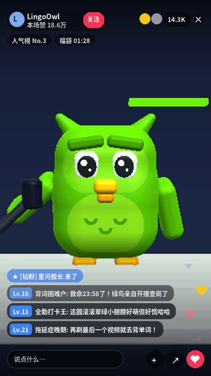</a> | <a href="examples/duolingo-chill-night-market/assets/duolingo_chill_night_market.mp4">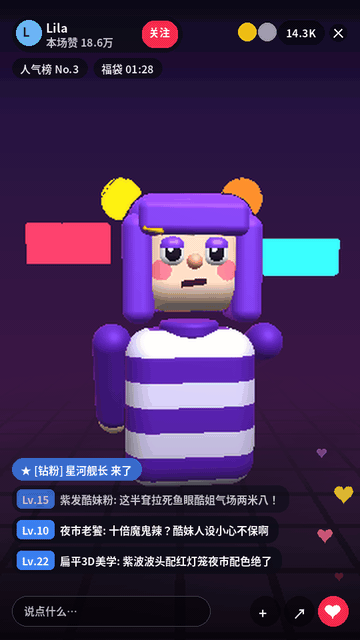</a> | <a href="examples/tux-ferris-code-webcam/assets/tux_ferris_code_webcam.mp4">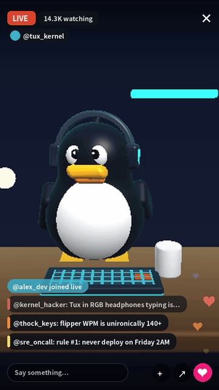</a> | <a href="examples/godot-bot-unboxing-af/assets/godot_bot_unboxing_af.mp4">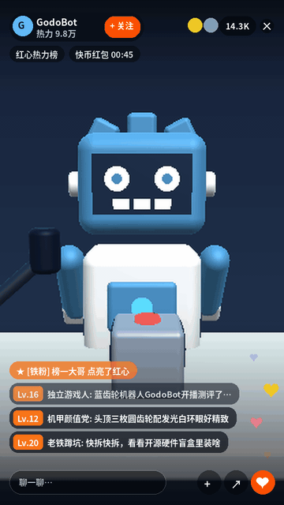</a> |
| **`8×8` Voxel · Wuxia Selfie** | **Roblox R6 · Sky-Obby PiP** | **Roblox DOORS · IG Selfie** | **Roblox 50/50 · Co-Host PK** |
| <a href="examples/voxel-wuxia-sword-live/assets/voxel_wuxia_sword_live.mp4">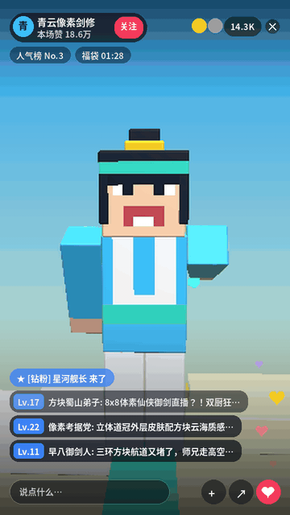</a> | <a href="examples/roblox-obby-rage-pip/assets/roblox_obby_rage_pip.mp4"></a> | <a href="examples/roblox-doors-irl-selfie/assets/roblox_doors_irl_selfie.mp4"></a> | <a href="examples/roblox-pet-hatch-pk/assets/roblox_pet_hatch_pk.mp4"></a> |

## Scene boards and shot pacing

Video diffusion models lose physical camera truth when a single 4–5 second clip chains multiple actions or switches mounts mid-shot. Each livestream short splits any plot into four single-action live beats (`0–3.5s` cold-open claim, `3.5–7.5s` `15°` chat-read or `[AF-C]` proof, `7.5–11.5s` unscripted live twist, and `11.5–15s` chat-flood payoff):

| Shot 01 · Hook (`0–3.5s`) | Shot 02 · Chat Read (`3.5–7.5s`) | Shot 03 · Alert Twist (`7.5–11.5s`) | Shot 04 · Payoff (`11.5–15s`) |
| :---: | :---: | :---: | :---: |
| 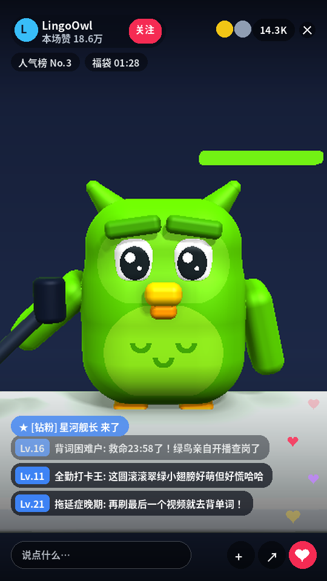 | 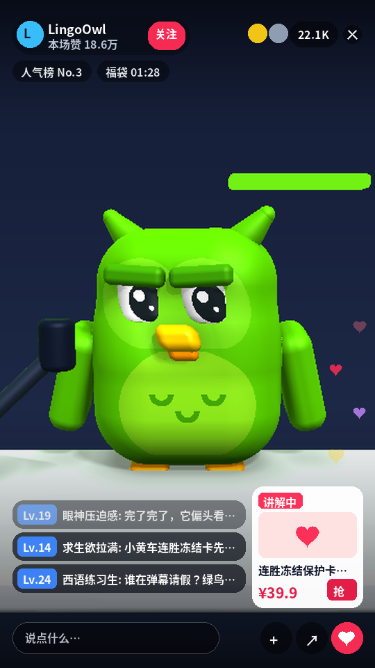 | 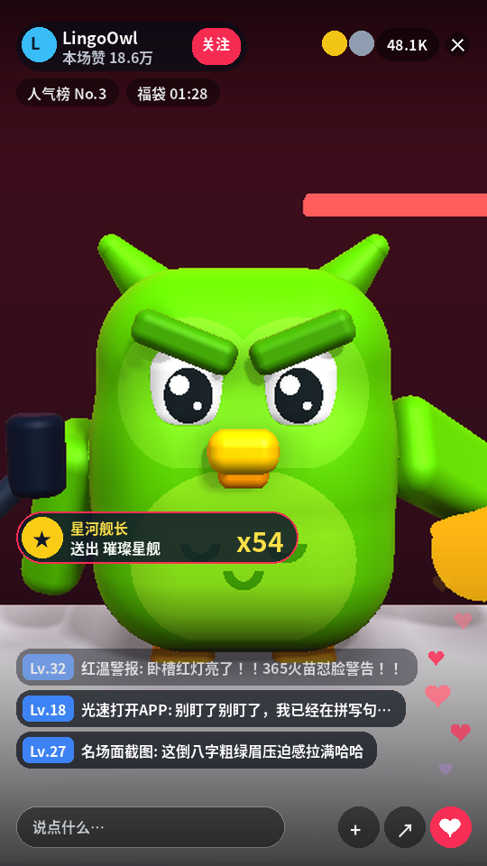 | 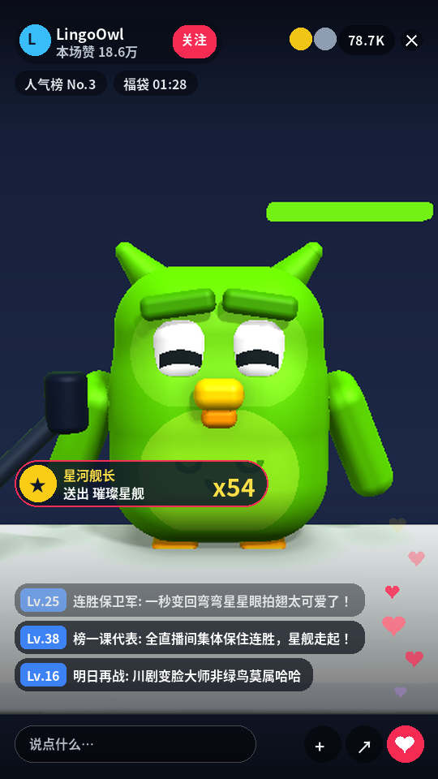 |

Physical livestream optics and visual art style are completely orthogonal (`8 Camera Rigs × 8 Style Packs`). The `3×2` high-DPI matrix below shows how the exact same fourth-wall camera grammar adapts across **Duolingo mascots, flat-3D casts, Linux Tux & CC0 Ferris, Godot Gear-Bot, `8×8` Voxel Wuxia, and Roblox R6 PiP**:

<p align="center">
  
</p>

Full-width HD four-shot contact sheets (every danmaku pill, combo counter, and expression shift is directly legible at README width; click any board to open its prompt package):

<p align="center">
  <a href="examples/tux-ferris-code-webcam/">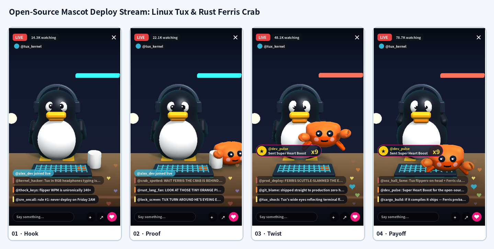</a>
</p>

<p align="center">
  <a href="examples/voxel-wuxia-sword-live/">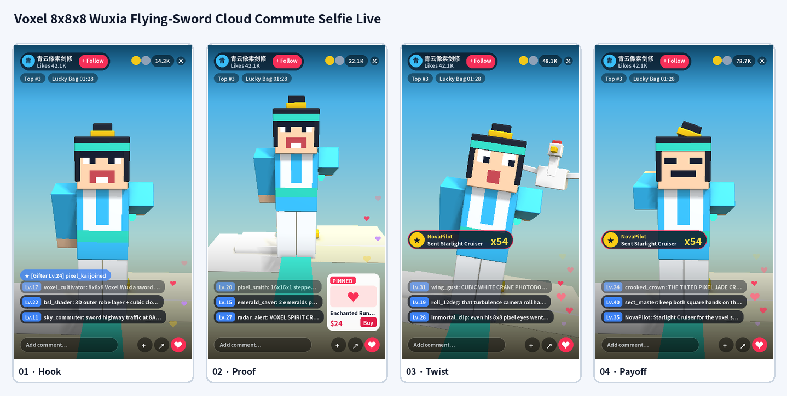</a>
</p>

<p align="center">
  <a href="examples/roblox-pet-hatch-pk/">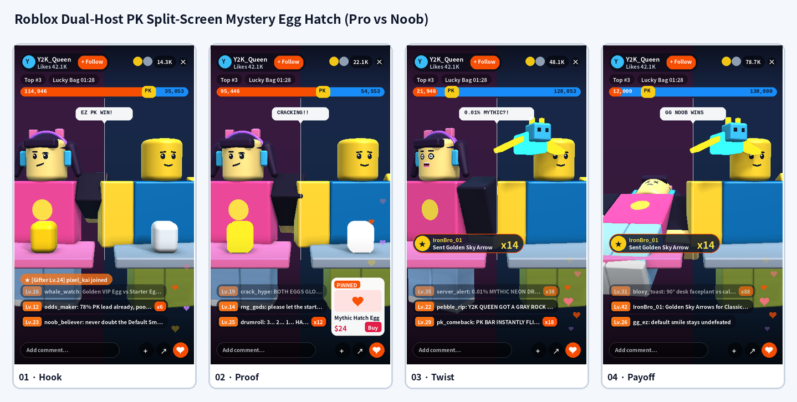</a>
</p>

<details>
<summary>Expand the remaining 5 full-width HD storyboard sheets (Duolingo Owl · Night-Market Lila · Godot Gear-Bot · Roblox Sky-Obby PiP · Roblox DOORS Selfie)</summary>

<p align="center">
  <a href="examples/duolingo-owl-streak-cam/">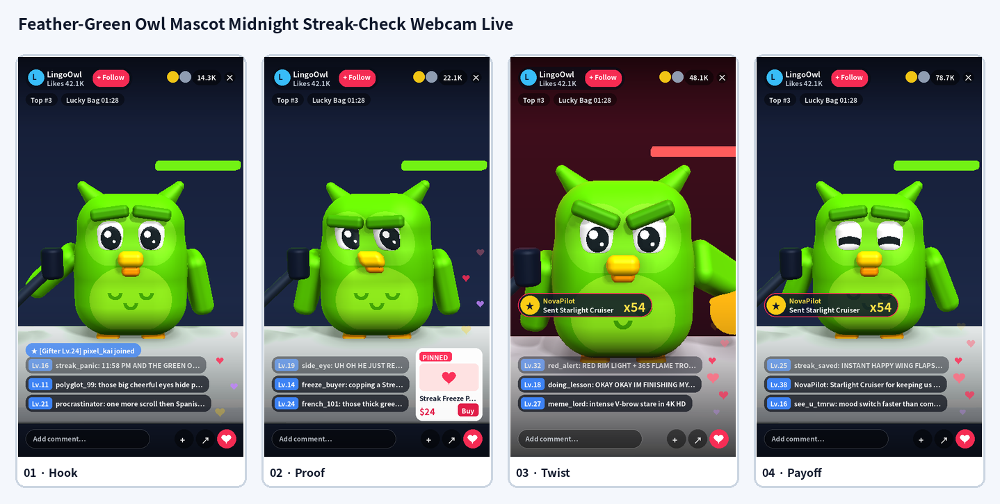</a>
</p>
<p align="center">
  <a href="examples/duolingo-chill-night-market/">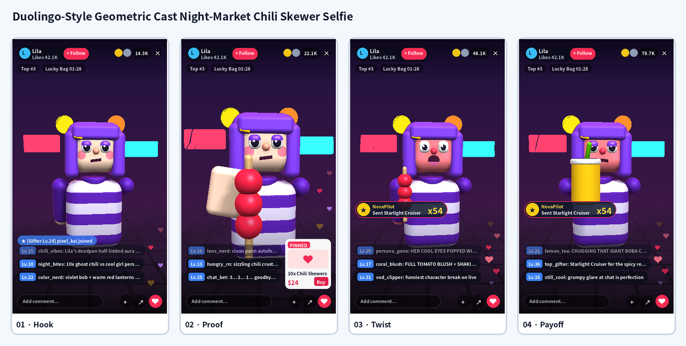</a>
</p>
<p align="center">
  <a href="examples/godot-bot-unboxing-af/">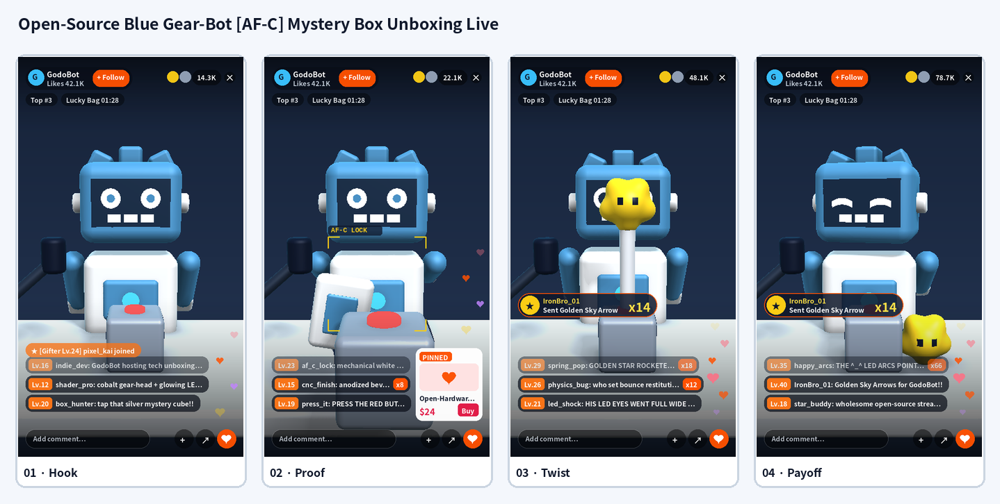</a>
</p>
<p align="center">
  <a href="examples/roblox-obby-rage-pip/">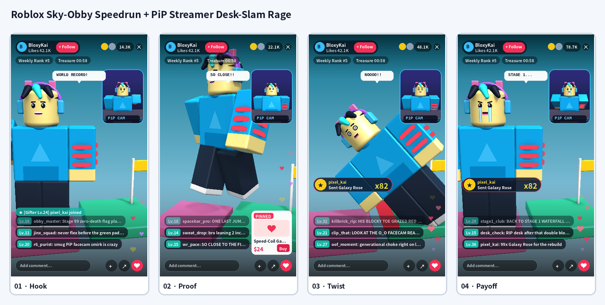</a>
</p>
<p align="center">
  <a href="examples/roblox-doors-irl-selfie/">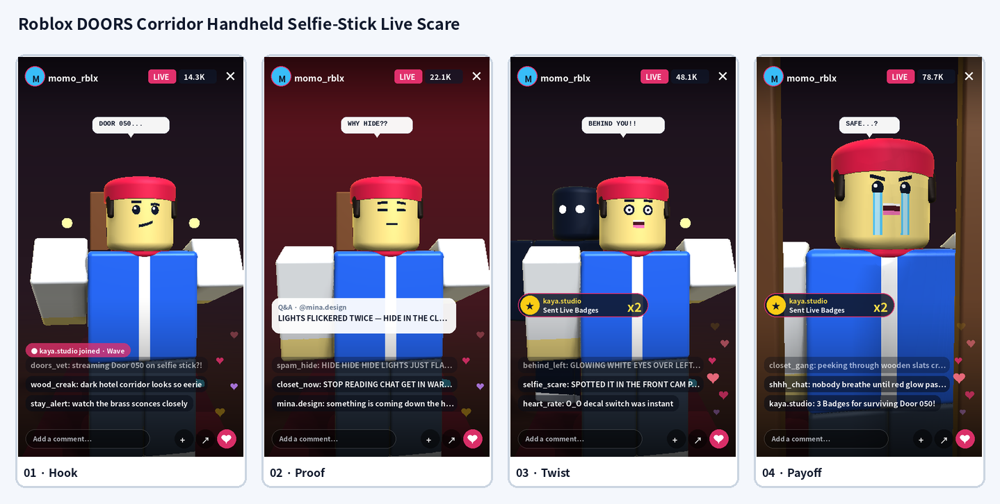</a>
</p>

</details>

Six `3×2` high-DPI platform chrome cards (`douyin`, `kuaishou`, `instagram`, `x`, `tiktok`, plus `clean` zero-HUD raw camera plate)—covering safe-zone headers, join ribbons, 2-slot gift combos, live shopping cards, frosted Q&A cards, `1v1 PK` tug-of-war bars, and Periscope 6-color heart fountains ([REA ledger](references/platform-ui-rea-ledger.md)):

<p align="center">
  
</p>

To layer interactive overlays onto any external `.mp4` or OBS scene, open [`studio/index.html`](studio/index.html) directly in a browser:

<p align="center">
  
</p>

## Skill workflow and quick start

<p align="center">
  
</p>

### Install as an Agent Skill

Clone this skill into your agent host's skills directory. Once installed, the agent reads [`SKILL.md`](SKILL.md), loads the relevant camera/HUD guides from [`references/`](references/), and runs the Node.js scripts automatically when you ask for a livestream-perspective short. This path is for Codex; use `~/.copilot/skills/livestream-style-video` for GitHub Copilot, or your configured skills folder in Claude Code and Cursor.

```bash
git clone https://github.com/yuzhang-zhong/livestream-style-video.git ~/.codex/skills/livestream-style-video
```

Trigger the `livestream-style-video` skill in your agent chat:

```text
Use $livestream-style-video to adapt "a plump green language-tutor owl hosting an 11:58 PM streak check-in stream when chat makes excuses"
into a 15-second 9:16 desktop-webcam livestream with Douyin live shopping and gift combo overlays.
Give me the camera rig lock, a 4-shot clean-plate storyboard, and Kling / Seedance I2V prompts.
```

### Run the skill's CLI tools directly

Every helper script bundled inside the skill also runs standalone from the repository root on Node.js 18+ using only the standard library (no `npm install` or API keys; `python3` Pillow + `ffmpeg` enable high-DPI HUD compositing, 256-color GIFs, and `720p` H.264 MP4 encoding).

```bash
node scripts/render_preview.mjs --spec templates/custom_livestream_spec.json --out-dir out/ferris-ramen --platform douyin --force
node scripts/shot_compiler.mjs --plot "Open-source crab chef reading live chat at 2am when the ramen broth pot boils over" --style opensource-mascot --platform douyin --engine kling --lang en
node scripts/drift_check.mjs --pack templates/custom_livestream_spec.json --engine kling --lang en
```

## Skill scripts, anti-drift checks, and references

Prompting `"a livestream video with comments"` directly in video diffusion models triggers detached third-person crane shots, burned-in alien gibberish UI text, uncanny plastic mannequin faces, or human fingers on blocky Roblox streamers. `drift_check.mjs` flags these failure modes across 8 gates before generation so external models render clean raw camera plates while `render_preview.mjs` and [`studio/index.html`](studio/index.html) composite crisp HUDs:

<p align="center">
  
</p>

| Skill component | Output |
| --- | --- |
| [`SKILL.md`](SKILL.md) | Main Agent Skill entry point defining the 6 production modes (`Rig-Spec`, `Plot-to-Live`, `Prompt-Compile`, `Platform-HUD`, `Rescue`, `Render`) and 8 livestream invariants. |
| [`shot_compiler.mjs`](scripts/shot_compiler.mjs) | Compiles `--plot "<any story>"`, `--spec <episode.json>`, or 8 built-in templates into non-repeating 15s / 30s / 45s 9:16 clean-plate prompts + HUD timelines (`local3d`, Kling, Seedance, Hailuo, Wan, Sora, Veo, Runway). |
| [`rig_spec.mjs`](scripts/rig_spec.mjs) | Locks 8 physical camera rigs × 8 orthogonal visual styles (`duolingo-mascot`, `opensource-mascot`, `roblox-blocky`, `voxel-sandbox`, `anime-vtuber`, `stylized-3d`, `cinematic-genre-adapt`, `realistic-irl`) and a [3-state setup sheet](assets/showcase/rig_setup_sheet.en.png) prompt. |
| [`hud_presets.mjs`](scripts/hud_presets.mjs) | `1080×1920` safe zones, comment styles, 2-slot gift combos, shopping/Q&A popups, PK bars, and heart palettes for `douyin`, `kuaishou`, `instagram`, `x`, `tiktok`, and `clean`. |
| [`drift_check.mjs`](scripts/drift_check.mjs) | 8-gate Unicode-safe linter (`--prompt` or `--pack`) catching cinema crane drift, gibberish UI text, uncanny mannequin drift, T2V PiP melt, and Roblox five-finger/Lego leaks. |
| [`render_preview.mjs`](scripts/render_preview.mjs) | Direct local soft-shadow + AO 3D & Post-HUD renderer (`720×1280` H.264 MP4, 256-color GIF, and full-width bilingual contact sheets). |
| [`studio/index.html`](studio/index.html) | Browser / OBS interactive HUD studio with 4 live `<canvas>` character rigs, MP4 plate loader, popup triggers, and `#00FF00` chroma-key export. |

[Camera rigs and optics](references/camera-rigs-and-optics.md) · [Style adapters matrix](references/style-adapters-matrix.md) · [Plot-to-livestream beats](references/plot-to-livestream-beats.md) · [Platform UI REA ledger](references/platform-ui-rea-ledger.md) · [Model prompt playbook](references/model-prompt-playbook.md) · [Drift fixes](references/rescue-and-anti-drift.md) · [8 story templates](references/viral-livestream-archetypes.md)

## Languages

Agent Skill replies and CLI `--lang` output support `en`, `zh`, `zh-tw`, `ja`, `ko`, `es`, `fr`, `de`, `pt`, and `ru`.

**English** · [简体中文](README.zh-CN.md) · [繁體中文](docs/i18n/README.zh-TW.md) · [日本語](docs/i18n/README.ja.md) · [한국어](docs/i18n/README.ko.md) · [Español](docs/i18n/README.es.md) · [Français](docs/i18n/README.fr.md) · [Deutsch](docs/i18n/README.de.md) · [Português](docs/i18n/README.pt-BR.md) · [Русский](docs/i18n/README.ru.md)

[MIT License](LICENSE). Independent open-source Agent Skill; uses clean-room geometric UI reconstructions and original/CC0/open-source-inspired mascot geometry, unaffiliated with Duolingo, ByteDance, Kuaishou, Meta, X Corp., or Roblox Corporation.
