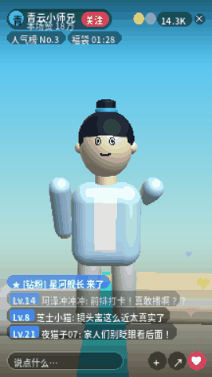
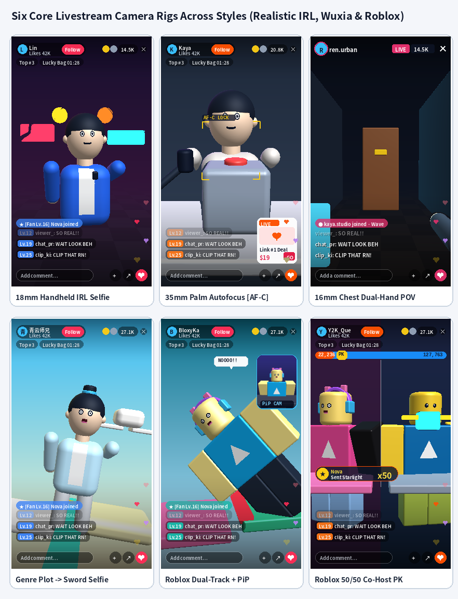

<div align="center">


# Livestream POV Video Skill

Turn any visual style or storyline into a 9:16 livestream camera perspective: lock physical webcam/selfie/POV rigs, compile clean-plate I2V/T2V prompts without gibberish UI text, and overlay reconstructed Douyin, Kuaishou, Instagram Live, X, or TikTok chrome locally.

[](SKILL.md)
[](#install-and-quick-start)
[](LICENSE)

**[Video samples](#livestream-pov-samples)** · [Platform HUD matrix](#reconstructed-livestream-chrome-and-fx-rea) · [Camera rigs & anti-drift](#camera-rigs-and-clean-plate-workflow) · [Install & quick start](#install-and-quick-start) · [Skill guide](SKILL.md)

**English** · [简体中文](README.zh-CN.md) · [繁體中文](docs/i18n/README.zh-TW.md) · [日本語](docs/i18n/README.ja.md) · [한국어](docs/i18n/README.ko.md) · [Español](docs/i18n/README.es.md) · [Français](docs/i18n/README.fr.md) · [Deutsch](docs/i18n/README.de.md) · [Português](docs/i18n/README.pt-BR.md) · [Русский](docs/i18n/README.ru.md)

</div>

[](assets/showcase/livestream_pov_reel.mp4)

## Livestream POV samples

Each package maps a storyline into four single-action 9:16 live beats (`0–3.5s` hook, `3.5–7.5s` close-up proof, `7.5–11.5s` unscripted live twist, `11.5–15s` chat-flood reaction). The GIFs and H.264 MP4s below are deterministic local 3D + Post-HUD previews rendered by `scripts/render_preview.mjs` to check camera mounts, eye-lines, and safe zones before running external diffusion models (`Kling`, `Seedance`, `Hailuo`, `Wan`, `Sora`, `Veo`, `Runway`). Click any preview to open the MP4 with synthesized live room audio.

### General & cross-genre AI video samples

| 01 · Night-Market Selfie (`Kling` · Douyin HUD) | 02 · Desk Autofocus Unboxing (`Seedance` · Kuaishou HUD) | 03 · Midnight Corridor POV (`Sora` · IG Live HUD) |
| :---: | :---: | :---: |
| [](examples/irl-night-market-selfie/assets/irl_night_market_selfie.mp4) | [](examples/desk-unboxing-autofocus/assets/desk_unboxing_autofocus.mp4) | [](examples/midnight-corridor-fpv-live/assets/midnight_corridor_fpv_live.mp4) |
| `18mm` arm's-length selfie + `20cm` chili skewer focus pull.<br>[MP4](examples/irl-night-market-selfie/assets/irl_night_market_selfie.mp4) · [Board](examples/irl-night-market-selfie/assets/storyboard_sheet.en.png) · [Prompts](examples/irl-night-market-selfie/) | `35mm` locked boom-left desk + `[AF-C]` palm focus + spring pop.<br>[MP4](examples/desk-unboxing-autofocus/assets/desk_unboxing_autofocus.mp4) · [Board](examples/desk-unboxing-autofocus/assets/storyboard_sheet.en.png) · [Prompts](examples/desk-unboxing-autofocus/) | `16mm` dual-hand chest POV (left chat phone + right flashlight).<br>[MP4](examples/midnight-corridor-fpv-live/assets/midnight_corridor_fpv_live.mp4) · [Board](examples/midnight-corridor-fpv-live/assets/storyboard_sheet.en.png) · [Prompts](examples/midnight-corridor-fpv-live/) |

| 04 · Late-Night Study Webcam (`Wan` · X / Periscope HUD) | 05 · Wuxia Flying-Sword Commute (`Hailuo` · Genre Plot → Live) |
| :---: | :---: |
| [](examples/late-night-study-webcam/assets/late_night_study_webcam.mp4) | [](examples/wuxia-sword-flight-live/assets/wuxia_sword_flight_live.mp4) |
| `24mm` monitor-top cam: ginger cat ears peek behind chair before hitting Enter.<br>[MP4](examples/late-night-study-webcam/assets/late_night_study_webcam.mp4) · [Board](examples/late-night-study-webcam/assets/storyboard_sheet.en.png) · [Prompts](examples/late-night-study-webcam/) | Adapts a fantasy/wuxia plot into an `18mm` cloud-sea selfie stream.<br>[MP4](examples/wuxia-sword-flight-live/assets/wuxia_sword_flight_live.mp4) · [Board](examples/wuxia-sword-flight-live/assets/storyboard_sheet.en.png) · [Prompts](examples/wuxia-sword-flight-live/) |

### Roblox blocky livestream samples

| 06 · Sky-Obby + Corner PiP (`Hailuo` · TikTok HUD) | 07 · DOORS Corridor Selfie (`Sora` · IG Live HUD) | 08 · 50/50 Co-Host Egg PK (`Kling` · Kuaishou HUD) |
| :---: | :---: | :---: |
| [](examples/roblox-obby-rage-pip/assets/roblox_obby_rage_pip.mp4) | [](examples/roblox-doors-irl-selfie/assets/roblox_doors_irl_selfie.mp4) | [](examples/roblox-pet-hatch-pk/assets/roblox_pet_hatch_pk.mp4) |
| Dual-track `R6` obby Killbrick fail + RGB headset desk-slam PiP.<br>[MP4](examples/roblox-obby-rage-pip/assets/roblox_obby_rage_pip.mp4) · [Board](examples/roblox-obby-rage-pip/assets/storyboard_sheet.en.png) · [Prompts](examples/roblox-obby-rage-pip/) | `18mm` blocky selfie stick catches glowing eyes over left shoulder.<br>[MP4](examples/roblox-doors-irl-selfie/assets/roblox_doors_irl_selfie.mp4) · [Board](examples/roblox-doors-irl-selfie/assets/storyboard_sheet.en.png) · [Prompts](examples/roblox-doors-irl-selfie/) | `50/50` locked dual webcam: starter egg hatches a Blocky Mythic Dragon.<br>[MP4](examples/roblox-pet-hatch-pk/assets/roblox_pet_hatch_pk.mp4) · [Board](examples/roblox-pet-hatch-pk/assets/storyboard_sheet.en.png) · [Prompts](examples/roblox-pet-hatch-pk/) |

## Reconstructed livestream chrome and FX (REA)

Asking video diffusion models to render TikTok/Douyin comments or gift banners directly produces garbled text. This repository separates **clean-plate camera generation** from **post-composited platform chrome**, reconstructing five mainstream room layouts, popup state machines, and heart fountains from wire-protocol schemas, safe-zone specs, and REA static/browser verification ([`references/platform-ui-rea-ledger.md`](references/platform-ui-rea-ledger.md)):

<p align="center">
  
</p>

Open [`studio/index.html`](studio/index.html) directly in a browser or OBS Browser Source to load any clean `.mp4` plate (or switch to `#00FF00` chroma-key mode for NLE compositing) and trigger live events interactively:

<p align="center">
  
</p>

- **Douyin (`douyin`) & TikTok (`tiktok`)**: Rounded top-left host capsule, Top 3 coin gifter badges, `Chat_Feed_Stack` (`rgba(0,0,0,0.36)`, `22%` top alpha fade, `[Fan Lv.16]` tags), 2-slot mid-left `Gift_Combo` accumulator (`×66` bounce), and bottom-right Live Shopping deal card (`小黄车讲解卡`).
- **Kuaishou (`kuaishou`)**: `1080×1920` safe-zone calibrated header (`340px` top / `620px` bottom), warm `#FF5000` accent, `点亮了红心` join feed, spammed danmaku combo badges (`×18`), and orange-vs-blue `PK` tug-of-war bar.
- **Instagram Live (`instagram`)**: Story-ring avatar, rectangular `#E1306C` `LIVE` + viewer pill, borderless drop-shadow comment stream, inline `joined · Wave` notice, and frosted-glass **Live Q&A Question Card**.
- **X / Periscope (`x`)**: Obsidian `#0F1419` chat cards with viewer-assigned left color bars and Periscope's 6-tint (`#fce473`, `#f68b39`, `#ed6c63`, `#847bb9`, `#97cd76`, `#35b1d1`) sinusoidal heart fountain.

## Camera rigs and clean-plate workflow

<p align="center">
  
</p>

Eight physical camera mounts (`desktop-webcam`, `handheld-selfie-irl`, `pip-facecam-rig`, `overhead-showcase-rig`, `chest-head-pov`, `pk-cohost-split`, `cctv-obs-fixed`, `drone-follow-live`) pair orthogonally with six visual style packs (`realistic-irl`, `roblox-blocky`, `anime-vtuber`, `stylized-3d`, `voxel-sandbox`, `cinematic-genre-adapt`):

<p align="center">
  
</p>

Before running I2V/T2V, `scripts/drift_check.mjs` enforces 8 static gates—catching third-person cinema crane drift, burned-in gibberish UI requests, single-pass T2V PiP melt, action overload, and style anatomy leaks (such as human fingers or Lego studs on Roblox streamers):

<p align="center">
  
</p>

## Install and quick start

### Install as an Agent Skill

Clone into your coding agent's skills directory (`~/.codex/skills/livestream-pov-video` for Codex, `~/.copilot/skills/livestream-pov-video` for GitHub Copilot, or your configured skills folder in Claude Code and Cursor):

```bash
git clone https://github.com/yuzhang-zhong/livestream-pov-video.git ~/.copilot/skills/livestream-pov-video
```

Invoke in chat with any plot and style:

```text
Use $livestream-pov-video to adapt "a medieval knight unboxing an enchanted sword at a dragon cave entrance when the dragon wakes up"
into a 15-second 9:16 handheld selfie livestream with Douyin live shopping & gift combo overlays.
Give me the rig setup card, 4-shot clean-plate Kling I2V prompts, and render a local preview MP4.
```

### Run CLI tools directly

All scripts run offline on Node.js 18+ using standard library modules only (`python3` + Pillow and `ffmpeg` enable anti-aliased CJK HUD compositing and H.264 MP4 export):

```bash
node scripts/rig_spec.mjs --rig handheld-selfie-irl --style realistic-irl --host "Lin" --lang en --out out/rig_card.md
node scripts/shot_compiler.mjs --plot "Ramen stall chef reading live chat at 2am when the broth pot boils over" --platform douyin --engine kling --json --out out/ramen_live.json
node scripts/drift_check.mjs --pack out/ramen_live.json --engine kling --lang en
node scripts/render_preview.mjs --spec out/ramen_live.json --out-dir out/assets --platform douyin --force
```

## Components and reference guides

| Component | Purpose |
| --- | --- |
| [`SKILL.md`](SKILL.md) | Main Agent Skill entry point defining the 8 livestream POV invariants and 6 production modes. |
| [`scripts/rig_spec.mjs`](scripts/rig_spec.mjs) | Locks camera optics, `0°/15°` eye-line, mic side, style geometry, and [3-state setup sheet](assets/showcase/rig_setup_sheet.en.png) prompts. |
| [`scripts/shot_compiler.mjs`](scripts/shot_compiler.mjs) | Translates `--plot "<any story>"`, `--spec`, or 8 built-in templates into 15s/30s/45s clean-plate prompts + HUD timelines. |
| [`scripts/hud_presets.mjs`](scripts/hud_presets.mjs) | Safe-zone metrics, comment styles, popup queues, and heart palettes for `douyin`, `kuaishou`, `instagram`, `x`, `tiktok`, and `clean`. |
| [`scripts/drift_check.mjs`](scripts/drift_check.mjs) | 8-gate Unicode-safe linter blocking cinema drift, gibberish UI, PiP T2V melt, and Roblox/voxel anatomy leaks. |
| [`scripts/render_preview.mjs`](scripts/render_preview.mjs) | Parallel 3D SDF raymarcher + multi-platform HUD compositor outputting `.mp4` (with WAV live audio), `.gif`, and contact sheets. |
| [`studio/index.html`](studio/index.html) | Interactive browser/OBS overlay studio supporting local MP4 plates, popup triggers, PK tug-of-war, and `#00FF00` chroma-key export. |

[Camera rigs & optics](references/camera-rigs-and-optics.md) · [Style adapters matrix](references/style-adapters-matrix.md) · [Plot-to-livestream beats](references/plot-to-livestream-beats.md) · [REA platform UI ledger](references/platform-ui-rea-ledger.md) · [Model prompt playbook](references/model-prompt-playbook.md) · [Anti-drift rescue guide](references/rescue-and-anti-drift.md) · [8 livestream templates](references/viral-livestream-archetypes.md)

## Languages

Agent responses and CLI `--lang` flags support `en`, `zh`, `zh-tw`, `ja`, `ko`, `es`, `fr`, `de`, `pt`, and `ru`.

**English** · [简体中文](README.zh-CN.md) · [繁體中文](docs/i18n/README.zh-TW.md) · [日本語](docs/i18n/README.ja.md) · [한국어](docs/i18n/README.ko.md) · [Español](docs/i18n/README.es.md) · [Français](docs/i18n/README.fr.md) · [Deutsch](docs/i18n/README.de.md) · [Português](docs/i18n/README.pt-BR.md) · [Русский](docs/i18n/README.ru.md)

[MIT License](LICENSE). Independent open-source Agent Skill using clean-room geometric UI reconstructions; not affiliated with or endorsed by ByteDance, Kuaishou, Meta, X Corp., or Roblox Corporation.
