<div align="center">

# Livestream Style Video Skill

一套面向 Claude Code、Cursor、GitHub Copilot 与 Codex 的 **Agent Skill**（`SKILL.md` + 领域词库 + 零依赖命令行脚本）：把任意画风与剧情转译为 `9:16` 竖屏直播视角四镜分镜，编译无乱码的纯净视频生成提示词，复刻主流直播间边框特效，并在本地直出 `720p` 高清预演成片。

[](skills/livestream-style-video/SKILL.md)
[](#skill-工作流与安装使用)
[](LICENSE)

**[高清短片示例](#短片示例)** · [跨画风角色与直播界面](#跨画风机位与多平台直播界面) · [Skill 工作流与安装](#skill-工作流与安装使用) · [Skill 指南](skills/livestream-style-video/SKILL.md)

[English](README.md) · **简体中文** · [繁體中文](docs/i18n/README.zh-TW.md) · [日本語](docs/i18n/README.ja.md) · [한국어](docs/i18n/README.ko.md) · [Español](docs/i18n/README.es.md) · [Français](docs/i18n/README.fr.md) · [Deutsch](docs/i18n/README.de.md) · [Português](docs/i18n/README.pt-BR.md) · [Русский](docs/i18n/README.ru.md)

</div>

<a name="示例与本地-3d-预览"></a>

## 短片示例

作为可挂载的 Agent Skill，本项目在对话中可将任意故事与画风拆解为 15 秒、4 镜头（`9:16` 竖屏）的完整直播视角短片包。内置 8 套无恐怖谷高表现力样本（**Duolingo 多邻国风几何萌宠与扁平 3D 角色**、**Linux Tux / CC0 Rust Ferris / Godot 齿轮机器人等开源吉祥物 IP**、**Minecraft `8×8` 体素仙侠**，以及 **Roblox R6 立体配件方块人**）。点击任意动图可直接播放带合成直播间音效的 `720×1280` MP4：

| Duolingo 绿鸟 · 抖音查岗 | 扁平 3D 酷妹 · 夜市自拍 | Linux Tux + Ferris · X 桌播 | Godot 机器人 · 快手 `[AF-C]` |
| :---: | :---: | :---: | :---: |
| <a href="examples/duolingo-owl-streak-cam/assets/duolingo_owl_streak_cam.mp4">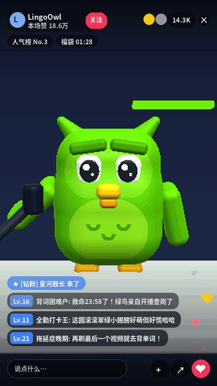</a> | <a href="examples/duolingo-chill-night-market/assets/duolingo_chill_night_market.mp4">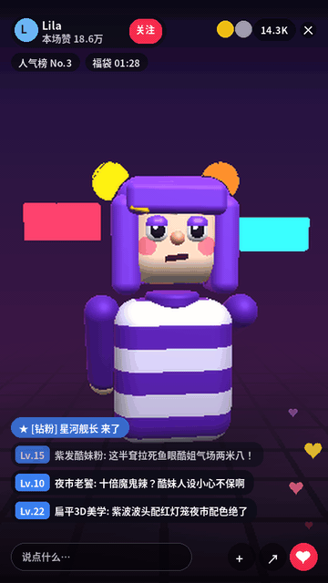</a> | <a href="examples/tux-ferris-code-webcam/assets/tux_ferris_code_webcam.mp4">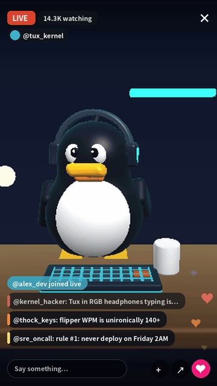</a> | <a href="examples/godot-bot-unboxing-af/assets/godot_bot_unboxing_af.mp4"></a> |
| **`8×8` 体素剑修 · 御剑自拍** | **Roblox 跑酷 · 双轨画中画** | **Roblox 走廊 · Ins 自拍杆** | **Roblox 连麦 · 50/50 PK** |
| <a href="examples/voxel-wuxia-sword-live/assets/voxel_wuxia_sword_live.mp4">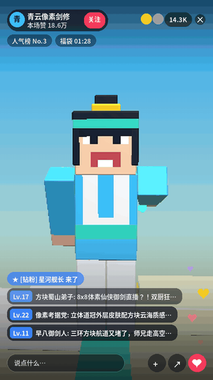</a> | <a href="examples/roblox-obby-rage-pip/assets/roblox_obby_rage_pip.mp4"></a> | <a href="examples/roblox-doors-irl-selfie/assets/roblox_doors_irl_selfie.mp4"></a> | <a href="examples/roblox-pet-hatch-pk/assets/roblox_pet_hatch_pk.mp4"></a> |

<a name="分镜拆解与多平台直播表"></a>

## 跨画风机位与多平台直播界面

视频生成模型在单个 4 至 5 秒片段里如果串联多步剧情或中途切机位，很容易退化成疏离的电影空镜。每支 15 秒直播短片固定拆成四个单动作节拍（`0–3.5s` 开播立 Flag、`3.5–7.5s` 偏轴读弹幕或对焦自证、`7.5–11.5s` 突发直播高能、`11.5–15s` 破防或反转收尾）：

| 镜头 01 · 开播查岗 (`0–3.5s`) | 镜头 02 · 扫视弹幕 (`3.5–7.5s`) | 镜头 03 · 红温警告 (`7.5–11.5s`) | 镜头 04 · 星星眼收尾 (`11.5–15s`) |
| :---: | :---: | :---: | :---: |
| 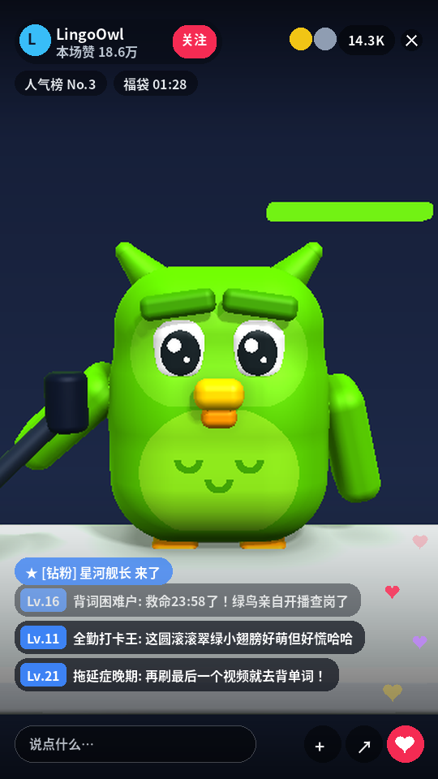 | 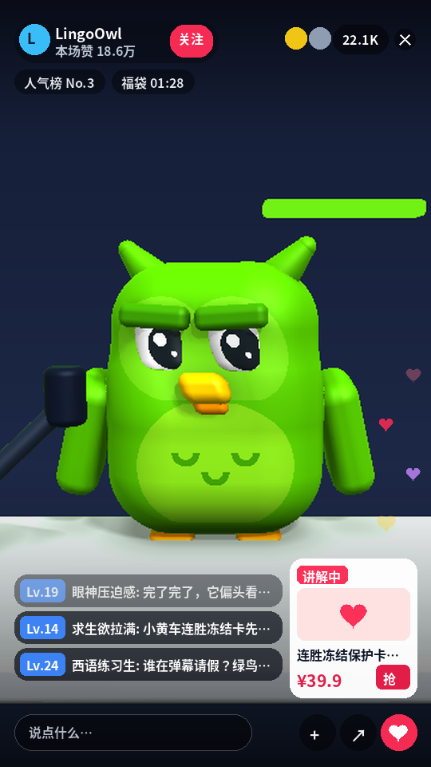 | 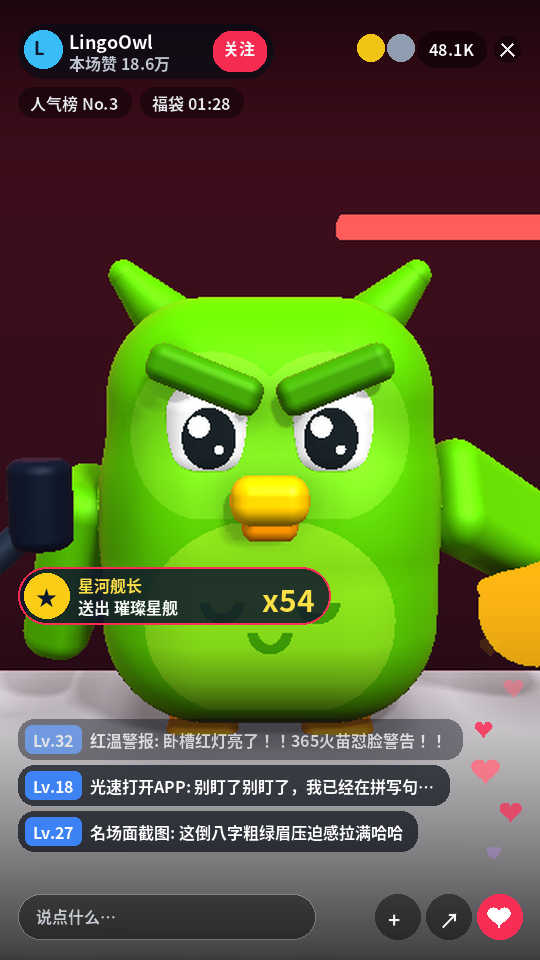 | 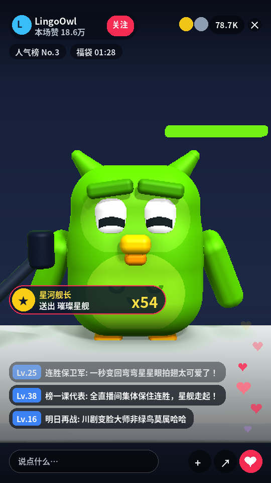 |

物理直播机位与角色画风完全正交解耦（`8 大机位 × 8 类画风`）。下方 `3×2` 高清矩阵直观展示同一套直播语言在 **Duolingo 几何萌宠、扁平 3D 角色、Linux Tux + Ferris 开源吉祥物、Godot 齿轮机器人、`8×8` 体素仙侠与 Roblox R6 画中画**上的落地效果：

<p align="center">
  
</p>

代表性全宽高清四镜头分镜联系表（单图直读全部弹幕、连击与表情变化，点击图片可进入对应完整提示词工程包）：

<p align="center">
  <a href="examples/tux-ferris-code-webcam/">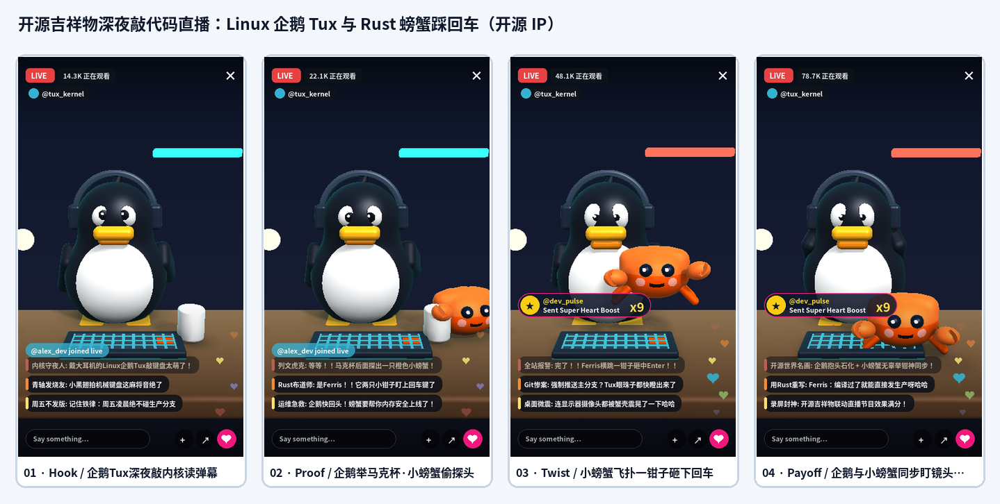</a>
</p>

<p align="center">
  <a href="examples/voxel-wuxia-sword-live/">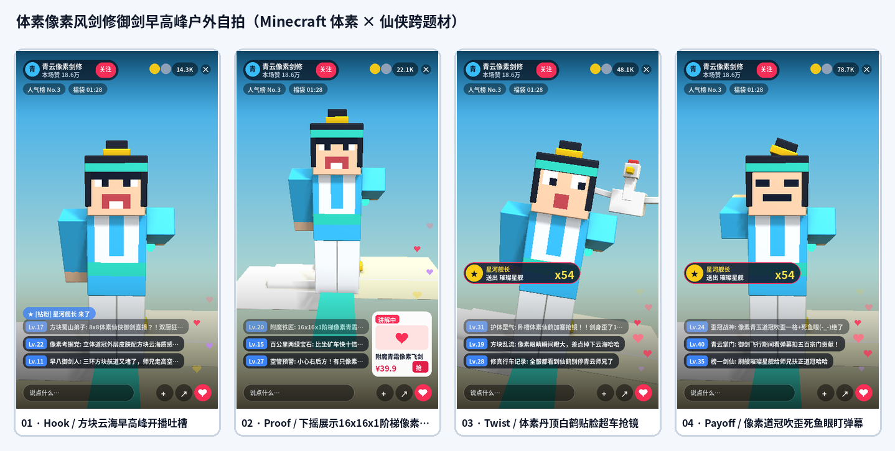</a>
</p>

<p align="center">
  <a href="examples/roblox-pet-hatch-pk/">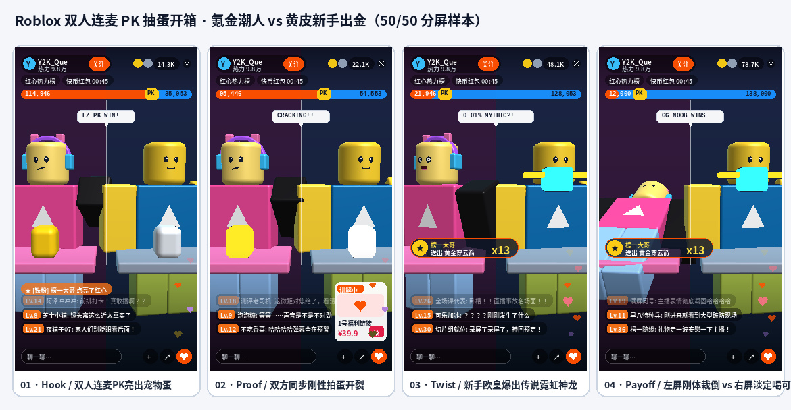</a>
</p>

<details>
<summary>展开查看其余 5 套样本的全宽高清四镜分镜表（Duolingo 绿鸟 / 夜市酷妹 / Godot 机器人 / Roblox 跑酷 PiP / DOORS 走廊）</summary>

<p align="center">
  <a href="examples/duolingo-owl-streak-cam/">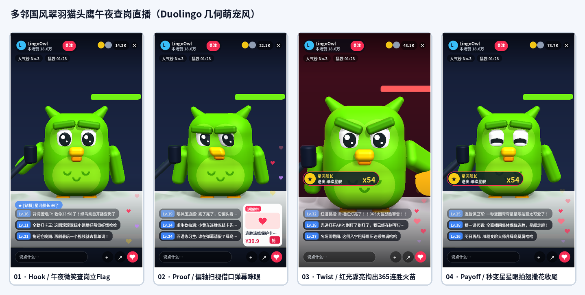</a>
</p>
<p align="center">
  <a href="examples/duolingo-chill-night-market/">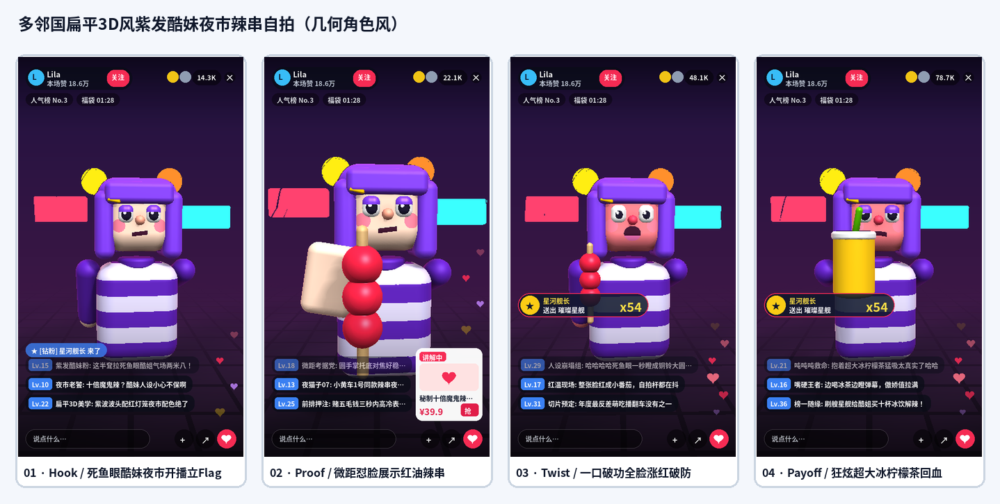</a>
</p>
<p align="center">
  <a href="examples/godot-bot-unboxing-af/">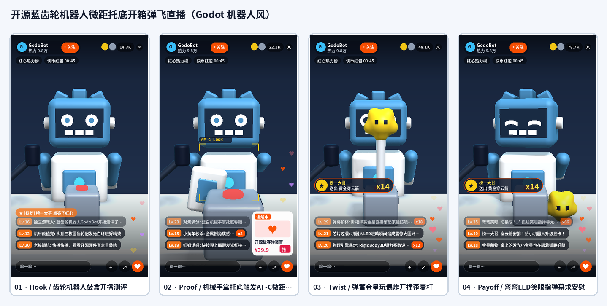</a>
</p>
<p align="center">
  <a href="examples/roblox-obby-rage-pip/">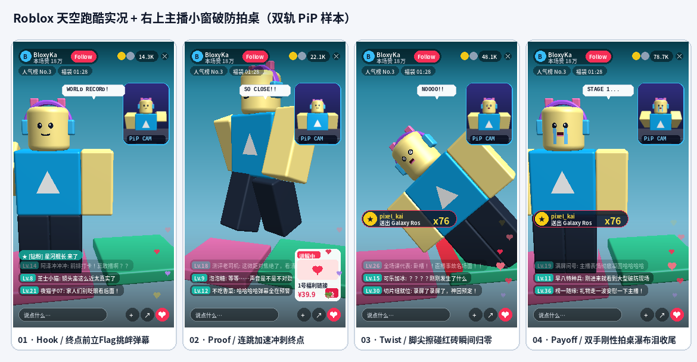</a>
</p>
<p align="center">
  <a href="examples/roblox-doors-irl-selfie/"></a>
</p>

</details>

内置经 REA 协议与样式逆向复刻的五大直播平台边框、交互弹窗与飘心特效（`douyin` 抖音小黄车讲解卡、`kuaishou` 快手连击弹幕与穿云箭、`instagram` 提问置顶卡、`x` 暗夜毛玻璃与 Periscope 六色飘心、`tiktok` 银河玫瑰连击，以及 `clean` 纯净生视频底片，详见[逆向台账](references/platform-ui-rea-ledger.md)）：

<p align="center">
  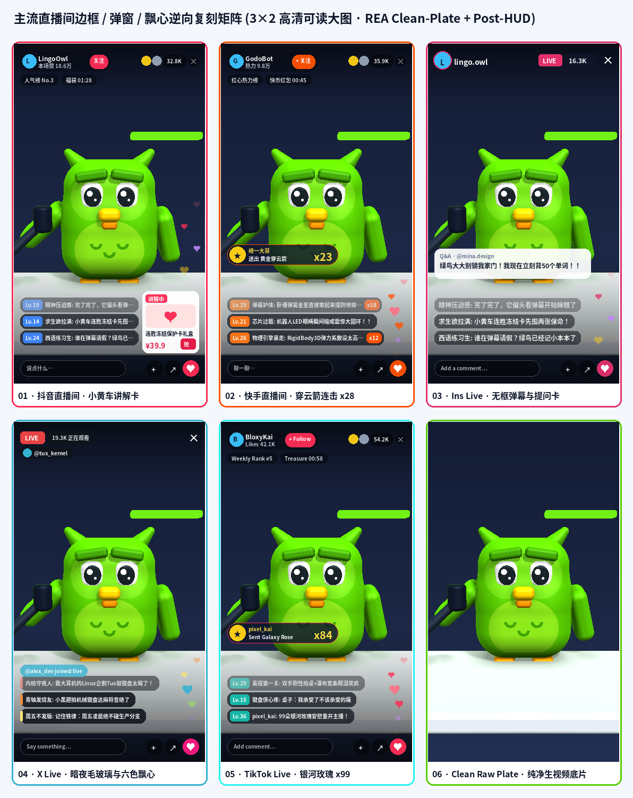
</p>

需要实时叠加到外部成片或 OBS 推流时，直接在浏览器打开 [`studio/index.html`](studio/index.html) 即可切换四大动态角色机位、导入本地 MP4 或开启 `#00FF00` 绿幕：

<p align="center">
  
</p>

## Skill 工作流与安装使用

<p align="center">
  
</p>

### 作为 Agent Skill 安装调用

将本仓库克隆到宿主工具的 Skills 目录后，AI 编程助手会自动按需读取 [`SKILL.md`](skills/livestream-style-video/SKILL.md) 与 [`references/`](references/) 参考手册并调用本地脚本。下方路径用于 Codex；GitHub Copilot 使用 `~/.copilot/skills/livestream-style-video`，Claude Code 与 Cursor 放入各自配置的 Skills 目录即可。

```bash
# 使用 GitHub CLI 或 Skills CLI 一键安装（支持 Claude Code、GitHub Copilot、Codex、Cursor、Gemini CLI）
gh skill install yuzhang-zhong/livestream-style-video livestream-style-video
npx skills add https://github.com/yuzhang-zhong/livestream-style-video --skill livestream-style-video

# 或手动克隆到宿主 Skills 目录
git clone https://github.com/yuzhang-zhong/livestream-style-video.git ~/.codex/skills/livestream-style-video
```

在 Agent 对话中直接调用 `livestream-style-video` Skill：

```text
使用 $livestream-style-video 把「多邻国风圆滚滚绿鸟深夜开播查岗背单词，看到观众找借口瞬间亮红灯掏出 365 连胜火苗」
规划成一支 15 秒 9:16 竖屏直播短片，套用抖音直播间小黄车讲解卡与礼物连击边框。
请给出直播机位与画风锁、4 镜头分镜表和可灵 / 即梦纯净底片图生视频提示词。
```

### 直接运行 Skill 内置命令行脚本

Skill 内附的脚本也可在普通克隆的仓库根目录独立运行，基于 Node.js 18+ 标准库，无需 `npm install` 或 API Key（配合 `python3` Pillow 与 `ffmpeg` 自动合成高清中文 HUD、`256` 色调色板 GIF 与 `720p` H.264 MP4）。

```bash
node scripts/render_preview.mjs --spec templates/custom_livestream_spec.json --out-dir out/ferris-ramen --platform douyin --force
node scripts/shot_compiler.mjs --plot "开源小螃蟹主厨深夜拉面摊自拍看弹幕，身后豚骨汤突然扑锅溢出来" --style opensource-mascot --platform douyin --engine kling --lang zh
node scripts/drift_check.mjs --pack templates/custom_livestream_spec.json --engine kling --lang zh
```

## Skill 脚本、防跑偏检查与参考文档

直接写「直播间画面、滚动弹幕文字」常会跑偏成第三人称电影摇臂空镜、焊死在画面像素里的外星乱码 UI、恐怖谷假人硅胶脸，或让 Roblox 主播长出真人五指。本 Skill 将**无字纯净镜头底片**与**后置高清直播 HUD** 分层，`drift_check.mjs` 会在生成前拦截这 8 类跑偏项：

<p align="center">
  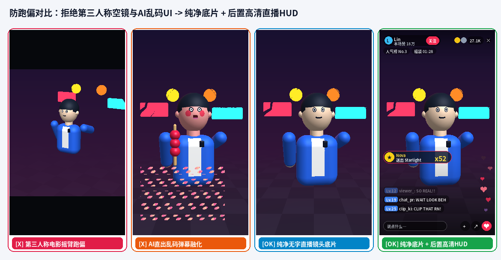
</p>

| Skill 组件 | 输出 |
| --- | --- |
| [`SKILL.md`](skills/livestream-style-video/SKILL.md) | Agent Skill 主入口说明，定义 6 种工作模式（机位设定、剧情转直播、提示词编译、平台 HUD、翻车修复、本地渲染）与 8 项直播视角约束。 |
| [`shot_compiler.mjs`](scripts/shot_compiler.mjs) | 支持 `--plot "<任意剧情>"`、`--spec <episode.json>` 或 8 套内置模板，生成零重复的 15s / 30s / 45s 竖屏纯净底片提示词与 HUD 时间轴（`local3d`、可灵、即梦、海螺、万相、Sora、Veo、Runway）。 |
| [`rig_spec.mjs`](scripts/rig_spec.mjs) | 锁定 8 种物理直播机位 × 8 类正交画风（`duolingo-mascot`、`opensource-mascot`、`roblox-blocky`、`voxel-sandbox`、`anime-vtuber`、`stylized-3d`、`cinematic-genre-adapt`、`realistic-irl`）与[直播间三态参考卡](assets/showcase/rig_setup_sheet.zh.png)。 |
| [`hud_presets.mjs`](scripts/hud_presets.mjs) | 抖音、快手、Instagram Live、X、TikTok 与纯净模式的 `1080×1920` 安全区、弹幕样式、双槽礼物连击、小黄车/问答弹窗与飘心色板。 |
| [`drift_check.mjs`](scripts/drift_check.mjs) | 8 门中英 Unicode 防跑偏审查器（支持 `--prompt` 与 `--pack`），拦截电影摇臂、乱码弹幕、恐怖谷硅胶假人脸、单轨 PiP 融化与 Roblox 五指/乐高圆粒。 |
| [`render_preview.mjs`](scripts/render_preview.mjs) | 本地软阴影 + 环境光遮蔽 3D + 后置高清 HUD 视频直出引擎，输出 `720×1280` H.264 MP4、`256` 色 GIF 与全宽双语分镜表。 |
| [`studio/index.html`](studio/index.html) | 独立浏览器 / OBS 交互式直播边框工作台，内置 4 套实时 `<canvas>` 角色机位预演、本地 MP4 导入、弹窗触发器与 `#00FF00` 绿幕导出。 |

[八大机位与光学](references/camera-rigs-and-optics.md) · [跨画风适配矩阵](references/style-adapters-matrix.md) · [任意剧情转直播节奏](references/plot-to-livestream-beats.md) · [五大平台界面逆向台账](references/platform-ui-rea-ledger.md) · [各模型提示词](references/model-prompt-playbook.md) · [跑偏修复](references/rescue-and-anti-drift.md) · [8 套分镜模板](references/viral-livestream-archetypes.md)

## 常见问题 · FAQ

<details>
<summary>为什么直接让 Sora、可灵（Kling）、即梦（Seedance）、海螺或通义万相生成直播间视频会出现弹幕乱码、小窗融化或电影空镜跑偏？</summary>

视频扩散模型直接绘制直播间文字会把弹幕和礼物框烧成无法阅读的外星乱码，或退化为不看镜头的第三人称电影摇臂镜头。本工具采用**纯净底片（Clean-Plate）+ 后置 HUD 分层合成**：先锁定 8 大物理直播机位（桌面摄像头、自拍杆夜市/御剑、右上角画中画双轨 `two separate clean plates`、手掌挡背后 `[AF-C]` 微距开箱、双人 50/50 连麦 PK）与 `15°` 偏轴读弹幕眼神生成零文字底片，再用 `render_preview.mjs` 或浏览器/OBS 工作台 [`studio/index.html`](studio/index.html) 叠加高清**抖音小黄车讲解卡、快手穿云箭连击、TikTok/Instagram/X 飘心边框或 `#00FF00` 绿幕素材**，是剪映付费直播边框模板的免费开源（MIT）平替。

</details>

## 语言

Agent Skill 回复与命令行 `--lang` 支持 `en`、`zh`、`zh-tw`、`ja`、`ko`、`es`、`fr`、`de`、`pt`、`ru`。

[English](README.md) · **简体中文** · [繁體中文](docs/i18n/README.zh-TW.md) · [日本語](docs/i18n/README.ja.md) · [한국어](docs/i18n/README.ko.md) · [Español](docs/i18n/README.es.md) · [Français](docs/i18n/README.fr.md) · [Deutsch](docs/i18n/README.de.md) · [Português](docs/i18n/README.pt-BR.md) · [Русский](docs/i18n/README.ru.md)

[MIT 许可证](LICENSE)。独立开源 Agent Skill 项目，内置洁净室几何重构直播界面与原创/CC0/开源灵感吉祥物模型，不使用官方商标台标，与 Duolingo、字节跳动、快手、Meta、X Corp. 或 Roblox Corporation 无隶属或背书关系。
