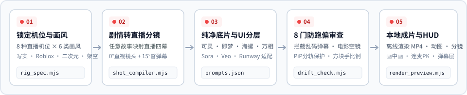
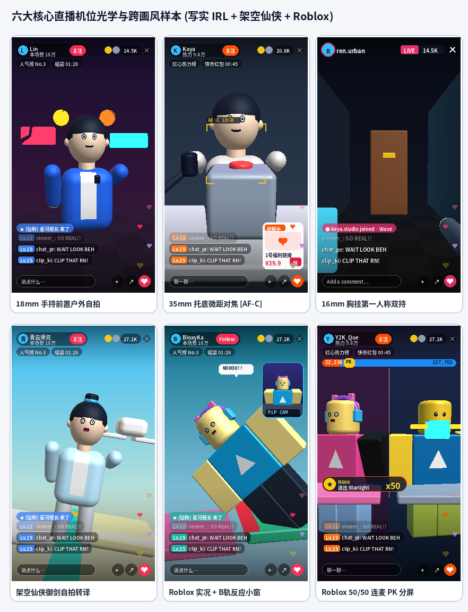

<div align="center">


# Livestream POV Video Skill

把任意画风与任意剧情转成真实的 9:16 直播间视角：锁死手持自拍杆、桌面摄像头、第一人称双持、画中画与连麦 PK 机位，编译零乱码的纯净 AI 视频底片提示词，并在本地无损叠加复刻版抖音、快手、Instagram Live、X 与 TikTok 直播边框、弹窗和飘心特效。

[](SKILL.md)
[](#安装与快速上手)
[](LICENSE)

**[直播短片样本](#直播视角短片样本)** · [五大平台边框与特效复刻](#主流直播间界面与交互逆向复刻-rea) · [机位矩阵与防跑偏](#六大直播机位与纯净底片工作流) · [安装与开始](#安装与快速上手) · [Skill 指南](SKILL.md)

[English](README.md) · **简体中文** · [繁體中文](docs/i18n/README.zh-TW.md) · [日本語](docs/i18n/README.ja.md) · [한국어](docs/i18n/README.ko.md) · [Español](docs/i18n/README.es.md) · [Français](docs/i18n/README.fr.md) · [Deutsch](docs/i18n/README.de.md) · [Português](docs/i18n/README.pt-BR.md) · [Русский](docs/i18n/README.ru.md)

</div>

[](assets/showcase/livestream_pov_reel.mp4)

## 直播视角短片样本

每支样本按 15 秒、4 个单动作直播节拍拆解（`0–3.5s` 开播立 Flag、`3.5–7.5s` 怼脸对焦实测、`7.5–11.5s` 直播翻车突发异变、`11.5–15s` 扫弹幕破防定格）。下方的 **GIF 与带音效 H.264 MP4** 由仓库自带的 `scripts/render_preview.mjs` 在本地离线渲染，用来在调用可灵、即梦、海螺、通义万相、Sora、Veo 或 Runway 生成最终视频前，先验证物理机位、眼神互动轴与直播 UI 安全区。点击任意动图可打开带现场音效的 MP4。

### 通用写实与跨题材剧情直播样本

| 01 · 夜市超广角自拍试吃 (`可灵` · 抖音边框) | 02 · 桌面微距对焦开箱弹飞 (`即梦` · 快手边框) | 03 · 深夜旧楼第一人称探险 (`Sora` · Ins 边框) |
| :---: | :---: | :---: |
| [](examples/irl-night-market-selfie/assets/irl_night_market_selfie.mp4) | [](examples/desk-unboxing-autofocus/assets/desk_unboxing_autofocus.mp4) | [](examples/midnight-corridor-fpv-live/assets/midnight_corridor_fpv_live.mp4) |
| `18mm` 一臂前置跟走 + `20cm` 烤串对焦 + 辣哭猛灌冰饮。<br>[MP4](examples/irl-night-market-selfie/assets/irl_night_market_selfie.mp4) · [分镜表](examples/irl-night-market-selfie/assets/storyboard_sheet.zh.png) · [提示词包](examples/irl-night-market-selfie/) | `35mm` 左置悬臂麦 + 网红托底 `[AF-C]` 对焦 + 弹簧炸开。<br>[MP4](examples/desk-unboxing-autofocus/assets/desk_unboxing_autofocus.mp4) · [分镜表](examples/desk-unboxing-autofocus/assets/storyboard_sheet.zh.png) · [提示词包](examples/desk-unboxing-autofocus/) | `16mm` 胸挂双持（左手冷光副机 + 右手电筒照 404 木门自开）。<br>[MP4](examples/midnight-corridor-fpv-live/assets/midnight_corridor_fpv_live.mp4) · [分镜表](examples/midnight-corridor-fpv-live/assets/storyboard_sheet.zh.png) · [提示词包](examples/midnight-corridor-fpv-live/) |

| 04 · 深夜赶工橘猫踩回车 (`万相` · X 多色飘心边框) | 05 · 仙侠御剑早高峰通勤 (`海螺` · 架空剧情转直播) |
| :---: | :---: |
| [](examples/late-night-study-webcam/assets/late_night_study_webcam.mp4) | [](examples/wuxia-sword-flight-live/assets/wuxia_sword_flight_live.mp4) |
| `24mm` 显示器摄像头：椅后先露猫耳朵让弹幕预警，再飞扑踩发送。<br>[MP4](examples/late-night-study-webcam/assets/late_night_study_webcam.mp4) · [分镜表](examples/late-night-study-webcam/assets/storyboard_sheet.zh.png) · [提示词包](examples/late-night-study-webcam/) | 演示任意非现代剧情如何通过 `18mm` 自拍玉简转译为直播感。<br>[MP4](examples/wuxia-sword-flight-live/assets/wuxia_sword_flight_live.mp4) · [分镜表](examples/wuxia-sword-flight-live/assets/storyboard_sheet.zh.png) · [提示词包](examples/wuxia-sword-flight-live/) |

### Roblox 方块小人直播视角样本

| 06 · 天空跑酷 + 右上反应小窗 (`海螺` · TikTok 边框) | 07 · DOORS 走廊自拍杆突脸 (`Sora` · Ins 边框) | 08 · 双人连麦 PK 抽蛋反杀 (`可灵` · 快手边框) |
| :---: | :---: | :---: |
| [](examples/roblox-obby-rage-pip/assets/roblox_obby_rage_pip.mp4) | [](examples/roblox-doors-irl-selfie/assets/roblox_doors_irl_selfie.mp4) | [](examples/roblox-pet-hatch-pk/assets/roblox_pet_hatch_pk.mp4) |
| A/B 双轨独立合成：锁死 `2×2×1` 比例与无手指实心方手拍桌流泪。<br>[MP4](examples/roblox-obby-rage-pip/assets/roblox_obby_rage_pip.mp4) · [分镜表](examples/roblox-obby-rage-pip/assets/storyboard_sheet.zh.png) · [提示词包](examples/roblox-obby-rage-pip/) | `18mm` 方块自拍杆前置纵深直接拍到身后白眼，冲进百叶衣柜收尾。<br>[MP4](examples/roblox-doors-irl-selfie/assets/roblox_doors_irl_selfie.mp4) · [分镜表](examples/roblox-doors-irl-selfie/assets/storyboard_sheet.zh.png) · [提示词包](examples/roblox-doors-irl-selfie/) | `50/50` 对称双摄像头连麦：黄皮新手孵出方块神龙瞬间反杀 PK 血条。<br>[MP4](examples/roblox-pet-hatch-pk/assets/roblox_pet_hatch_pk.mp4) · [分镜表](examples/roblox-pet-hatch-pk/assets/storyboard_sheet.zh.png) · [提示词包](examples/roblox-pet-hatch-pk/) |

## 主流直播间界面与交互逆向复刻 (REA)

在视频生成提示词里直接写「抖音直播界面、滚动弹幕文字、礼物按钮」，扩散模型会把外星乱码和融化的图标焊死在画面像素里。本仓库结合 **REA (`reverse-engineer-anything`)** 静态/浏览器场景取证、直播弹幕协议结构（`WebcastGiftMessage`、`SCWebFeedPush`）与官方 `1080×1920` 安全区规范，将**纯净镜头底片生成**与**后置高清直播间 HUD 合成**彻底解耦（详见 [`references/platform-ui-rea-ledger.md`](references/platform-ui-rea-ledger.md)）：

<p align="center">
  
</p>

除了命令行自动把 HUD 渲染进 MP4 外，仓库还内置了零依赖交互式工作台 [`studio/index.html`](studio/index.html)，用浏览器或 OBS 浏览器源直接打开即可导入任意本地 `.mp4` 纯净底片（或切换 `#00FF00` 绿幕抠像模式供剪映 / PR 叠加），实时触发各类弹窗与粒子特效：

<p align="center">
  
</p>

- **抖音直播间 (`douyin`) & TikTok (`tiktok`)**：左上圆角毛玻璃主播胶囊（头像 + 本场赞 + 关注红钮）、第二排人气榜与福袋倒计时、右上榜一至榜三贡献圆章、底部 `Chat_Feed_Stack`（`rgba(0,0,0,0.36)` 圆角气泡、顶部 `22%` 羽化渐隐遮罩、`[钻粉 Lv.16]` 灯牌）、中左双槽位礼物连击队列（`×66` 缩放回弹）及右下角**小黄车「讲解中」商品弹窗**。
- **快手直播间 (`kuaishou`)**：严格对齐 `1080×1920` 安全区（顶部避让 `340px`、底部评论区 `620px`），`#FF5000` 暖橙主色、`★ [铁粉] 点亮了红心` 提示、高频刷屏**弹幕连击角标 (`×18`)** 与橙蓝 `1v1 PK` 对抗拉条。
- **Instagram Live (`instagram`)**：左上彩虹故事环头像、右上 `#E1306C` 玫红 `LIVE` 与在线人数胶囊、**无背景框纯投影白色评论流**、`joined · Wave` 挥手条，以及居中毛玻璃 **Live Q&A 观众提问置顶卡**。
- **X / Periscope (`x`)**：`#0F1419` 暗夜玻璃独立弹幕卡（左侧 3px 观众专属色条）与标志性的 **Periscope 六色分配正弦曲线飘心喷泉**（`#fce473`、`#f68b39`、`#ed6c63`、`#847bb9`、`#97cd76`、`#35b1d1`）。

## 六大直播机位与纯净底片工作流

<p align="center">
  
</p>

Skill 内置 8 种物理直播采集机位（`desktop-webcam`、`handheld-selfie-irl`、`pip-facecam-rig`、`overhead-showcase-rig`、`chest-head-pov`、`pk-cohost-split`、`cctv-obs-fixed`、`drone-follow-live`），与 6 套视觉画风包（写实真人、Roblox R6 方块、二次元 VTuber、潮玩盲盒 3D、体素像素、古风/科幻/奇幻跨次元直播化）正交组合：

<p align="center">
  
</p>

调用外部视频模型前，`scripts/drift_check.mjs` 会执行 8 门静态审查，提前拦截电影摇臂远景跑偏、AI 乱码弹幕描述、单次文生视频画中画融化、单镜动作超载，以及 Roblox 主播长出真人五指或乐高圆粒等串味问题：

<p align="center">
  
</p>

## 安装与快速上手

### 作为 Agent Skill 挂载使用

将仓库克隆到宿主工具的 Skills 目录（Codex 使用 `~/.codex/skills/livestream-pov-video`，GitHub Copilot 使用 `~/.copilot/skills/livestream-pov-video`，Claude Code 与 Cursor 放入各自配置的 Skills 目录）：

```bash
git clone https://github.com/yuzhang-zhong/livestream-pov-video.git ~/.copilot/skills/livestream-pov-video
```

在对话里直接输入任意画风与剧情即可触发：

```text
使用 $livestream-pov-video 把「中世纪骑士在巨龙洞口举着水晶球自拍开箱圣剑，结果惊醒身后的红龙」
做成一支 15 秒 9:16 直播视角短片，套用抖音直播间小黄车与礼物连击边框。
请给出直播机位设定卡、4 镜头可灵 I2V 纯净底片提示词，并在本地渲染预览 MP4。
```

### 直接运行命令行脚本

所有脚本仅依赖 Node.js 18+ 标准库即可离线运行（配合系统 `python3` Pillow 与 `ffmpeg` 自动合成抗锯齿中文直播 HUD 与 H.264 MP4）：

```bash
node scripts/rig_spec.mjs --rig handheld-selfie-irl --style realistic-irl --host "阿泽" --lang zh --out out/rig_card.md
node scripts/shot_compiler.mjs --plot "凌晨两点街头拉面摊主边看弹幕谢榜一礼物，身后豚骨汤突然扑锅溢出来" --platform douyin --engine kling --json --out out/ramen_live.json
node scripts/drift_check.mjs --pack out/ramen_live.json --engine kling --lang zh
node scripts/render_preview.mjs --spec out/ramen_live.json --out-dir out/assets --platform douyin --force
```

## 核心组件与参考手册

| 组件 | 输出与职责 |
| --- | --- |
| [`SKILL.md`](SKILL.md) | Agent Skill 主入口，定义 8 项直播视角核心不变量与 6 种工作模式。 |
| [`scripts/rig_spec.mjs`](scripts/rig_spec.mjs) | 生成直播机位焦段、`0°/15°` 互动眼神轴、左置麦锁与[直播间三态一致性参考卡](assets/showcase/rig_setup_sheet.zh.png)提示词。 |
| [`scripts/shot_compiler.mjs`](scripts/shot_compiler.mjs) | 支持 `--plot "<任意剧情>"` 自由转译、`--spec` 自定义剧本或 8 套内置模板，编译纯净底片提示词与 HUD 时间轴。 |
| [`scripts/hud_presets.mjs`](scripts/hud_presets.mjs) | 抖音、快手、Instagram Live、X、TikTok 与纯净模式的安全区坐标、弹幕样式、连击槽与飘心色板定义。 |
| [`scripts/drift_check.mjs`](scripts/drift_check.mjs) | 8 门中英双语防跑偏审查器，拦截电影空镜、乱码弹幕、单轨 PiP 融化及 Roblox/体素手部串味并输出修复词。 |
| [`scripts/render_preview.mjs`](scripts/render_preview.mjs) | 本地多进程 3D 直播场景 + 多平台 HUD 合成渲染引擎，直出带现场音效的 `.mp4`、`.gif` 与双语分镜联系表。 |
| [`studio/index.html`](studio/index.html) | 独立浏览器 / OBS 交互式多平台直播边框工作台，支持导入本地 MP4、手动触发礼物/小黄车/PK/问答弹窗与绿幕导出。 |

[八大直播机位与光学规范](references/camera-rigs-and-optics.md) · [六类画风正交适配矩阵](references/style-adapters-matrix.md) · [任意剧情转直播四幕节奏](references/plot-to-livestream-beats.md) · [五大平台界面逆向台账 (REA)](references/platform-ui-rea-ledger.md) · [七大模型提示词手册](references/model-prompt-playbook.md) · [跑偏诊断与救场指南](references/rescue-and-anti-drift.md) · [八套高完播模板库](references/viral-livestream-archetypes.md)

## 语言

Agent 回复与命令行 `--lang` 支持 `en`、`zh`、`zh-tw`、`ja`、`ko`、`es`、`fr`、`de`、`pt`、`ru`。

[English](README.md) · **简体中文** · [繁體中文](docs/i18n/README.zh-TW.md) · [日本語](docs/i18n/README.ja.md) · [한국어](docs/i18n/README.ko.md) · [Español](docs/i18n/README.es.md) · [Français](docs/i18n/README.fr.md) · [Deutsch](docs/i18n/README.de.md) · [Português](docs/i18n/README.pt-BR.md) · [Русский](docs/i18n/README.ru.md)

[MIT 许可证](LICENSE)。独立开源 Agent Skill 项目，内置洁净室几何重构直播边框，不使用任何第三方官方台标商标，与字节跳动、快手、Meta、X Corp. 或 Roblox Corporation 无隶属或背书关系。
