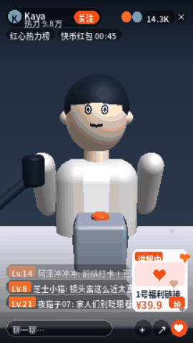
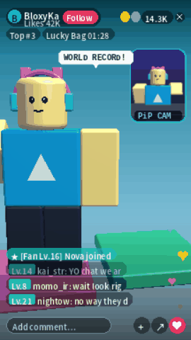

<div align="center">


# Livestream POV Video Skill

Verwandelt jeden visuellen Stil und jede Handlung in eine authentische vertikale `9:16`-Livestream-Perspektive: physische Kamerahalterungen fixieren (Webcam, Selfie-Gimbal, Brust-POV, PiP oder 50/50-PK-Splitscreen), saubere I2V/T2V-Prompts ohne KI-Textsalat kompilieren und rekonstruierte Overlays für Douyin, Kuaishou, Instagram Live, X und TikTok lokal einblenden.

[](../../SKILL.md)
[](#installation-und-schnellstart)
[](../../LICENSE)

[English](../../README.md) · [简体中文](../../README.zh-CN.md) · [繁體中文](README.zh-TW.md) · [日本語](README.ja.md) · [한국어](README.ko.md) · [Español](README.es.md) · [Français](README.fr.md) · **Deutsch** · [Português](README.pt-BR.md) · [Русский](README.ru.md)

</div>

[](../../assets/showcase/livestream_pov_reel.mp4)

## Video-Beispiele (Allgemeines KI-Video & Roblox)

Jedes Paket gliedert die Geschichte in vier Einzelaktions-Beats (`0–3.5s` Live-Hook, `3.5–7.5s` Nahaufnahme-Beweis, `7.5–11.5s` ungeskripteter Zwischenfall, `11.5–15s` Chat-Reaktion).

### Realistische & genreübergreifende KI-Video-Beispiele

| 01 · Nachtmarkt-Selfie (`Kling` · Douyin) | 02 · Tisch-Unboxing `[AF-C]` (`Seedance` · Kuaishou) | 03 · Mitternachtsflur POV (`Sora` · IG Live) |
| :---: | :---: | :---: |
| [](../../examples/irl-night-market-selfie/assets/irl_night_market_selfie.mp4) | [](../../examples/desk-unboxing-autofocus/assets/desk_unboxing_autofocus.mp4) | [](../../examples/midnight-corridor-fpv-live/assets/midnight_corridor_fpv_live.mp4) |
| `18mm` Selfie + `20cm` Chili-Spieß-Fokus.<br>[MP4](../../examples/irl-night-market-selfie/assets/irl_night_market_selfie.mp4) · [Board](../../examples/irl-night-market-selfie/assets/storyboard_sheet.en.png) · [Prompts](../../examples/irl-night-market-selfie/) | `35mm` Tischklemme + Handflächen-Autofokus `[AF-C]`.<br>[MP4](../../examples/desk-unboxing-autofocus/assets/desk_unboxing_autofocus.mp4) · [Board](../../examples/desk-unboxing-autofocus/assets/storyboard_sheet.en.png) · [Prompts](../../examples/desk-unboxing-autofocus/) | `16mm` Brustkamera mit Chat-Smartphone und Taschenlampe.<br>[MP4](../../examples/midnight-corridor-fpv-live/assets/midnight_corridor_fpv_live.mp4) · [Board](../../examples/midnight-corridor-fpv-live/assets/storyboard_sheet.en.png) · [Prompts](../../examples/midnight-corridor-fpv-live/) |

| 04 · Nachtschicht-Webcam & Katze (`Wan` · X / Periscope) | 05 · Wuxia-Schwertflug Live (`Hailuo` · Genre-Adaption) |
| :---: | :---: |
| [](../../examples/late-night-study-webcam/assets/late_night_study_webcam.mp4) | [](../../examples/wuxia-sword-flight-live/assets/wuxia_sword_flight_live.mp4) |
| `24mm` Monitor-Webcam: Katze landet auf der Enter-Taste.<br>[MP4](../../examples/late-night-study-webcam/assets/late_night_study_webcam.mp4) · [Board](../../examples/late-night-study-webcam/assets/storyboard_sheet.en.png) · [Prompts](../../examples/late-night-study-webcam/) | Übersetzt Fantasy-Stoffe in einen `18mm` Wolkenmeer-Selfie-Stream.<br>[MP4](../../examples/wuxia-sword-flight-live/assets/wuxia_sword_flight_live.mp4) · [Board](../../examples/wuxia-sword-flight-live/assets/storyboard_sheet.en.png) · [Prompts](../../examples/wuxia-sword-flight-live/) |

### Roblox-Livestream-Beispiele

| 06 · Sky-Obby + PiP-Facecam (`Hailuo` · TikTok) | 07 · DOORS-Flur Selfie (`Sora` · IG Live) | 08 · 50/50 Co-Host PK (`Kling` · Kuaishou) |
| :---: | :---: | :---: |
| [](../../examples/roblox-obby-rage-pip/assets/roblox_obby_rage_pip.mp4) | [](../../examples/roblox-doors-irl-selfie/assets/roblox_doors_irl_selfie.mp4) | [](../../examples/roblox-pet-hatch-pk/assets/roblox_pet_hatch_pk.mp4) |
| Zwei-Spur-Compositing mit `2×2×1`-Proportionen.<br>[MP4](../../examples/roblox-obby-rage-pip/assets/roblox_obby_rage_pip.mp4) · [Board](../../examples/roblox-obby-rage-pip/assets/storyboard_sheet.en.png) · [Prompts](../../examples/roblox-obby-rage-pip/) | `18mm` Selfie-Stick zeigt leuchtende Augen hinter der Schulter.<br>[MP4](../../examples/roblox-doors-irl-selfie/assets/roblox_doors_irl_selfie.mp4) · [Board](../../examples/roblox-doors-irl-selfie/assets/storyboard_sheet.en.png) · [Prompts](../../examples/roblox-doors-irl-selfie/) | `50/50`-Splitscreen: Noob zieht einen mythischen Block-Drachen.<br>[MP4](../../examples/roblox-pet-hatch-pk/assets/roblox_pet_hatch_pk.mp4) · [Board](../../examples/roblox-pet-hatch-pk/assets/storyboard_sheet.en.png) · [Prompts](../../examples/roblox-pet-hatch-pk/) |

## Rekonstruierte Plattform-HUDs und Effekte (REA)

Die Trennung zwischen sauberer Kamera-Aufnahme und nachträglichem HUD verhindert unleserliche KI-Schriftzeichen ([`references/platform-ui-rea-ledger.md`](../../references/platform-ui-rea-ledger.md)):

<p align="center">
  
</p>

Öffnen Sie [`studio/index.html`](../../studio/index.html) im Browser oder in OBS, um Geschenk-Combos, Shopping-Karten, PK-Balken und Herz-Fontänen interaktiv über eigene `.mp4`-Clips zu legen:

<p align="center">
  
</p>

## Workflow und Anti-Drift-Prüfung

<p align="center">
  
</p>

<p align="center">
  
</p>

## Installation und Schnellstart

```bash
git clone https://github.com/yuzhang-zhong/livestream-pov-video.git ~/.copilot/skills/livestream-pov-video
```

Direkte CLI-Nutzung unter Node.js 18+ ohne externe npm-Pakete:

```bash
node scripts/rig_spec.mjs --rig handheld-selfie-irl --style realistic-irl --host "Lin" --lang de --out out/rig_card.md
node scripts/shot_compiler.mjs --plot "Ein Ramen-Koch liest um 2 Uhr nachts den Live-Chat, während der Topf überkocht" --platform tiktok --engine kling --json --out out/ramen_live.json
node scripts/drift_check.mjs --pack out/ramen_live.json --engine kling --lang de
node scripts/render_preview.mjs --spec out/ramen_live.json --out-dir out/assets --platform tiktok --force
```

## Referenzen

- [`SKILL.md`](../../SKILL.md) · [Kamerarigs & Optik](../../references/camera-rigs-and-optics.md) · [Stil-Matrix](../../references/style-adapters-matrix.md) · [Handlung zu Live-Beats](../../references/plot-to-livestream-beats.md) · [REA-UI-Register](../../references/platform-ui-rea-ledger.md) · [Modell-Playbook](../../references/model-prompt-playbook.md) · [Anti-Drift-Hilfe](../../references/rescue-and-anti-drift.md)

[MIT-Lizenz](../../LICENSE). Unabhängiges Open-Source-Projekt; nicht verbunden mit ByteDance, Kuaishou, Meta, X Corp. oder Roblox Corporation.
