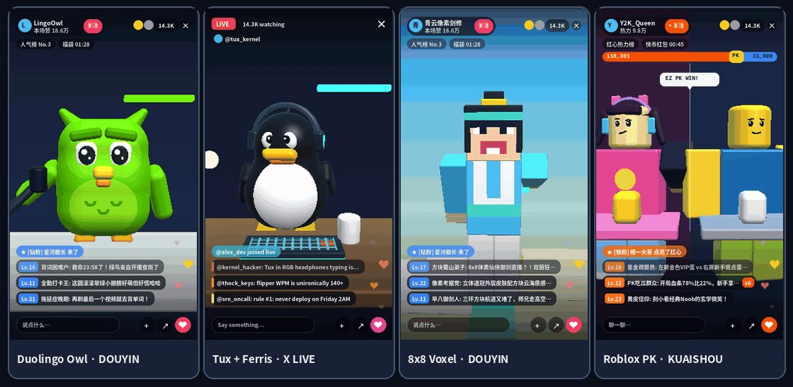
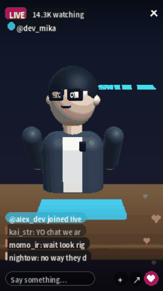

<div align="center">


# Livestream POV Video Skill

Convierte cualquier estilo visual o historia en una perspectiva auténtica de transmisión en vivo vertical (`9:16`): fija soportes físicos de cámara (webcam, selfie ultra gran angular, POV de pecho, PiP o pantalla dividida PK), compila prompts I2V/T2V limpios sin texto corrupto y superpón interfaces reconstruidas de Douyin, Kuaishou, Instagram Live, X y TikTok localmente.

[](../../SKILL.md)
[](#instalación-y-uso-rápido)
[](../../LICENSE)

[English](../../README.md) · [简体中文](../../README.zh-CN.md) · [繁體中文](README.zh-TW.md) · [日本語](README.ja.md) · [한국어](README.ko.md) · **Español** · [Français](README.fr.md) · [Deutsch](README.de.md) · [Português](README.pt-BR.md) · [Русский](README.ru.md)

</div>

[](../../assets/showcase/livestream_pov_reel.mp4)

## Ejemplos en video (IA general y Roblox)

Cada paquete divide la historia en cuatro pulsos de `9:16` (`0–3.5s` gancho en directo, `3.5–7.5s` prueba macro en lente, `7.5–11.5s` giro inesperado en vivo y `11.5–15s` reacción al chat).

### Muestras de video IA realista y adaptación de géneros

| 01 · Selfie en Mercado Nocturno (`Kling` · Douyin) | 02 · Unboxing con Autofoco `[AF-C]` (`Seedance` · Kuaishou) | 03 · Pasillo Nocturno POV (`Sora` · IG Live) |
| :---: | :---: | :---: |
| [](../../examples/irl-night-market-selfie/assets/irl_night_market_selfie.mp4) | [](../../examples/desk-unboxing-autofocus/assets/desk_unboxing_autofocus.mp4) | [](../../examples/midnight-corridor-fpv-live/assets/midnight_corridor_fpv_live.mp4) |
| Selfie `18mm` + enfoque `20cm` a brocheta picante.<br>[MP4](../../examples/irl-night-market-selfie/assets/irl_night_market_selfie.mp4) · [Tabla](../../examples/irl-night-market-selfie/assets/storyboard_sheet.en.png) · [Prompts](../../examples/irl-night-market-selfie/) | Cámara fija `35mm` + palma de enfoque `[AF-C]`.<br>[MP4](../../examples/desk-unboxing-autofocus/assets/desk_unboxing_autofocus.mp4) · [Tabla](../../examples/desk-unboxing-autofocus/assets/storyboard_sheet.en.png) · [Prompts](../../examples/desk-unboxing-autofocus/) | Cámara pectoral `16mm` con móvil de chat y linterna.<br>[MP4](../../examples/midnight-corridor-fpv-live/assets/midnight_corridor_fpv_live.mp4) · [Tabla](../../examples/midnight-corridor-fpv-live/assets/storyboard_sheet.en.png) · [Prompts](../../examples/midnight-corridor-fpv-live/) |

| 04 · Webcam Nocturna y Gato (`Wan` · X / Periscope) | 05 · Vuelo en Espada Wuxia (`Hailuo` · Fantasía en Vivo) |
| :---: | :---: |
| [](../../examples/late-night-study-webcam/assets/late_night_study_webcam.mp4) | [](../../examples/wuxia-sword-flight-live/assets/wuxia_sword_flight_live.mp4) |
| Webcam `24mm`: un gato salta sobre la tecla Enter.<br>[MP4](../../examples/late-night-study-webcam/assets/late_night_study_webcam.mp4) · [Tabla](../../examples/late-night-study-webcam/assets/storyboard_sheet.en.png) · [Prompts](../../examples/late-night-study-webcam/) | Adapta una trama fantástica a un selfie `18mm` sobre las nubes.<br>[MP4](../../examples/wuxia-sword-flight-live/assets/wuxia_sword_flight_live.mp4) · [Tabla](../../examples/wuxia-sword-flight-live/assets/storyboard_sheet.en.png) · [Prompts](../../examples/wuxia-sword-flight-live/) |

### Muestras de transmisión estilo Roblox

| 06 · Sky-Obby + Facecam PiP (`Hailuo` · TikTok) | 07 · Pasillo DOORS Selfie (`Sora` · IG Live) | 08 · Batalla PK 50/50 (`Kling` · Kuaishou) |
| :---: | :---: | :---: |
| [](../../examples/roblox-obby-rage-pip/assets/roblox_obby_rage_pip.mp4) | [](../../examples/roblox-doors-irl-selfie/assets/roblox_doors_irl_selfie.mp4) | [](../../examples/roblox-pet-hatch-pk/assets/roblox_pet_hatch_pk.mp4) |
| Doble pista `R6` + reacción en esquina con auriculares.<br>[MP4](../../examples/roblox-obby-rage-pip/assets/roblox_obby_rage_pip.mp4) · [Tabla](../../examples/roblox-obby-rage-pip/assets/storyboard_sheet.en.png) · [Prompts](../../examples/roblox-obby-rage-pip/) | Palo selfie `18mm` capta ojos brillantes tras el hombro.<br>[MP4](../../examples/roblox-doors-irl-selfie/assets/roblox_doors_irl_selfie.mp4) · [Tabla](../../examples/roblox-doors-irl-selfie/assets/storyboard_sheet.en.png) · [Prompts](../../examples/roblox-doors-irl-selfie/) | Pantalla dividida `50/50`: Noob eclosiona un dragón mítico.<br>[MP4](../../examples/roblox-pet-hatch-pk/assets/roblox_pet_hatch_pk.mp4) · [Tabla](../../examples/roblox-pet-hatch-pk/assets/storyboard_sheet.en.png) · [Prompts](../../examples/roblox-pet-hatch-pk/) |

## Interfaces y efectos reconstruidos con REA

Separar la placa de cámara limpia del HUD superpuesto evita texto corrupto en modelos de difusión ([`references/platform-ui-rea-ledger.md`](../../references/platform-ui-rea-ledger.md)):

<p align="center">
  
</p>

Abre [`studio/index.html`](../../studio/index.html) en tu navegador u OBS para superponer combos de regalos, tarjetas de compra, barras PK y corazones flotantes sobre cualquier `.mp4`:

<p align="center">
  
</p>

## Flujo de trabajo y control anti-deriva

<p align="center">
  
</p>

<p align="center">
  
</p>

## Instalación y uso rápido

```bash
git clone https://github.com/yuzhang-zhong/livestream-pov-video.git ~/.copilot/skills/livestream-pov-video
```

Ejecución directa en Node.js 18+ sin dependencias externas:

```bash
node scripts/rig_spec.mjs --rig handheld-selfie-irl --style realistic-irl --host "Lin" --lang es --out out/rig_card.md
node scripts/shot_compiler.mjs --plot "Un chef de ramen lee el chat en vivo a las 2am cuando la olla se desborda" --platform tiktok --engine kling --json --out out/ramen_live.json
node scripts/drift_check.mjs --pack out/ramen_live.json --engine kling --lang es
node scripts/render_preview.mjs --spec out/ramen_live.json --out-dir out/assets --platform tiktok --force
```

## Guías de referencia

- [`SKILL.md`](../../SKILL.md) · [Cámaras y óptica](../../references/camera-rigs-and-optics.md) · [Matriz de estilos](../../references/style-adapters-matrix.md) · [Trama a pulsos en vivo](../../references/plot-to-livestream-beats.md) · [Registro REA de interfaces](../../references/platform-ui-rea-ledger.md) · [Prompts por modelo](../../references/model-prompt-playbook.md) · [Guía anti-deriva](../../references/rescue-and-anti-drift.md)

[Licencia MIT](../../LICENSE). Proyecto independiente de código abierto; no afiliado a ByteDance, Kuaishou, Meta, X Corp. ni Roblox Corporation.
