<div align="center">

# Livestream Style Video Skill

Una **Agent Skill** (`SKILL.md` + guías de referencia + herramientas CLI sin dependencias) para Claude Code, Cursor, GitHub Copilot y Codex que adapta cualquier estilo visual o historia a cortos verticales (`9:16`) con perspectiva de transmisión en vivo, compila prompts limpios sin texto corrupto, superpone interfaces de salas en directo y previsualiza cortes localmente.

[](../../skills/livestream-style-video/SKILL.md)
[](#flujo-de-trabajo-e-inicio-rápido)
[](../../LICENSE)

**[Ejemplos en video](#ejemplos-en-video)** · [Tablas de escenas y HUDs](#tablas-de-escenas-y-ritmo-de-tomas) · [Flujo e inicio rápido](#flujo-de-trabajo-e-inicio-rápido) · [Guía Skill](../../skills/livestream-style-video/SKILL.md)

[English](../../README.md) · [简体中文](../../README.zh-CN.md) · [繁體中文](README.zh-TW.md) · [日本語](README.ja.md) · [한국어](README.ko.md) · **Español** · [Français](README.fr.md) · [Deutsch](README.de.md) · [Português](README.pt-BR.md) · [Русский](README.ru.md)

</div>

## Ejemplos en video

Al invocarse en un agente de programación, esta skill convierte cualquier estilo o trama en un paquete vertical (`9:16`) de 15 segundos y cuatro tomas a través de ocho formatos integrados (cinco transmisiones realistas y de fantasía más tres transmisiones estilo Roblox). Los **MP4** y GIF siguientes son animáticas 3D + Post-HUD renderizadas offline por `scripts/render_preview.mjs` para verificar soportes físicos de cámara, miradas `0°/15°` y zonas seguras antes de usar modelos externos.

<p align="center">
  <a href="../../examples/duolingo-owl-streak-cam/assets/duolingo_owl_streak_cam.mp4">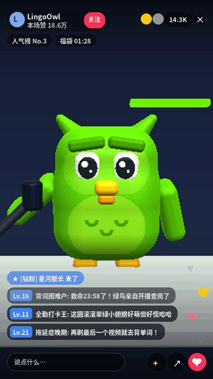</a>
  <a href="../../examples/duolingo-chill-night-market/assets/duolingo_chill_night_market.mp4">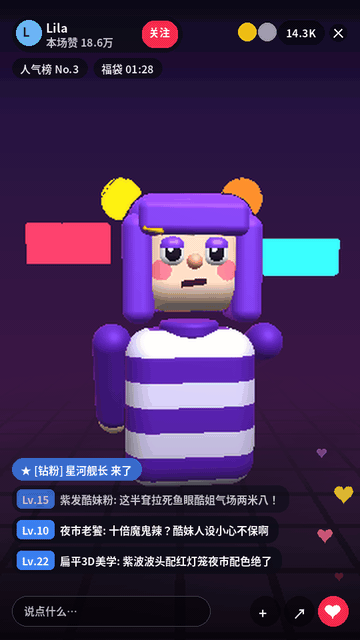</a>
  <a href="../../examples/tux-ferris-code-webcam/assets/tux_ferris_code_webcam.mp4">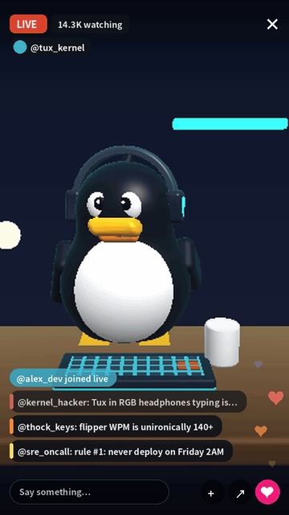</a>
  <a href="../../examples/godot-bot-unboxing-af/assets/godot_bot_unboxing_af.mp4">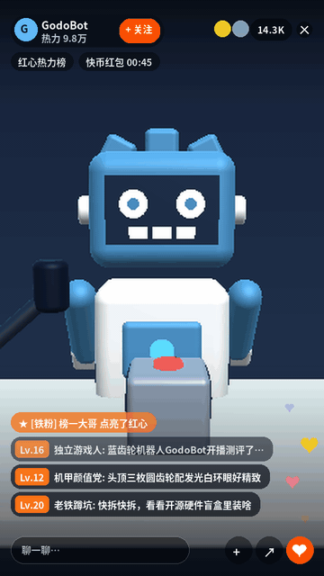</a>
  <br />
  <a href="../../examples/voxel-wuxia-sword-live/assets/voxel_wuxia_sword_live.mp4">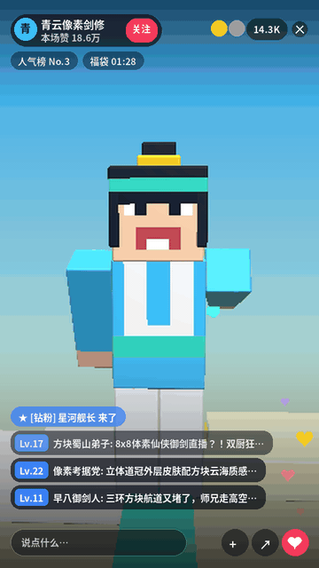</a>
  <a href="../../examples/roblox-obby-rage-pip/assets/roblox_obby_rage_pip.mp4"></a>
  <a href="../../examples/roblox-doors-irl-selfie/assets/roblox_doors_irl_selfie.mp4"></a>
  <a href="../../examples/roblox-pet-hatch-pk/assets/roblox_pet_hatch_pk.mp4"></a>
</p>

## Tablas de escenas y ritmo de tomas

Los modelos de video pierden la sensación de directo cuando un clip de 4–5 segundos encadena demasiadas acciones. Cada corto divide la historia en cuatro pulsos de una sola acción (`0–3.5s` gancho inicial, `3.5–7.5s` lectura `15°` o prueba macro, `7.5–11.5s` giro inesperado en vivo y `11.5–15s` reacción al chat):

| Shot 01 · Gancho (`0–3.5s`) | Shot 02 · Prueba (`3.5–7.5s`) | Shot 03 · Giro (`7.5–11.5s`) | Shot 04 · Remate (`11.5–15s`) |
| :---: | :---: | :---: | :---: |
| 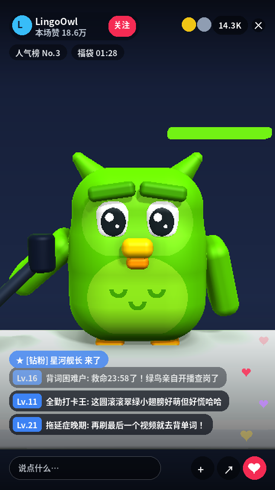 | 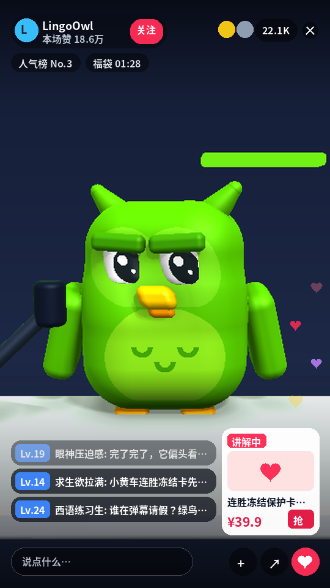 | 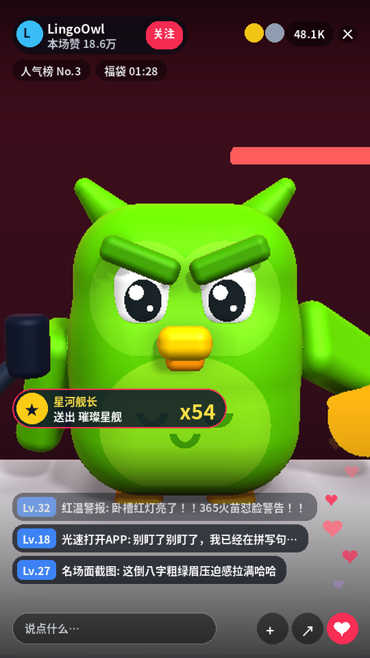 | 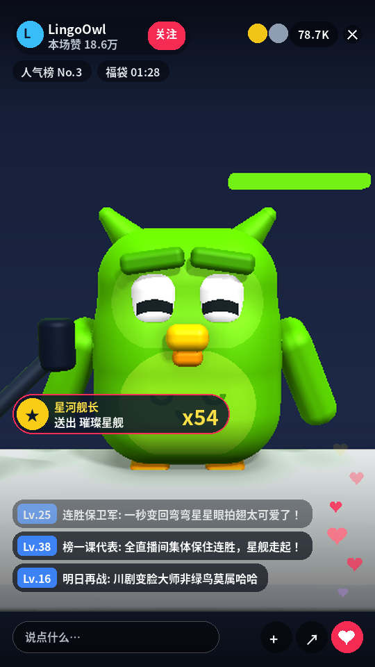 |

Matriz `3×2` HD de seis configuraciones de cámara y hojas de contacto de ancho completo:

<p align="center">
  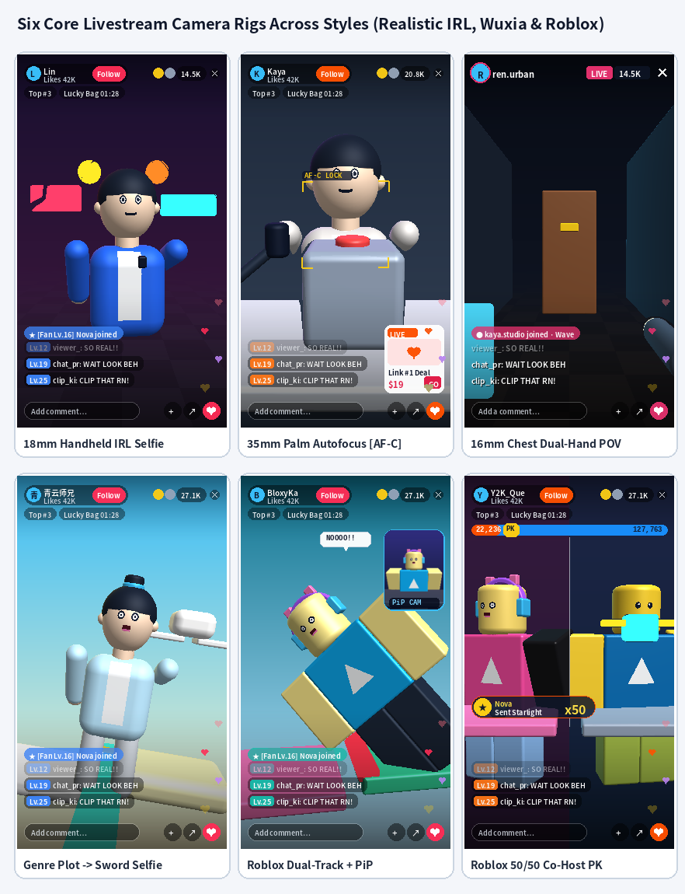
</p>

<p align="center">
  <a href="../../examples/tux-ferris-code-webcam/">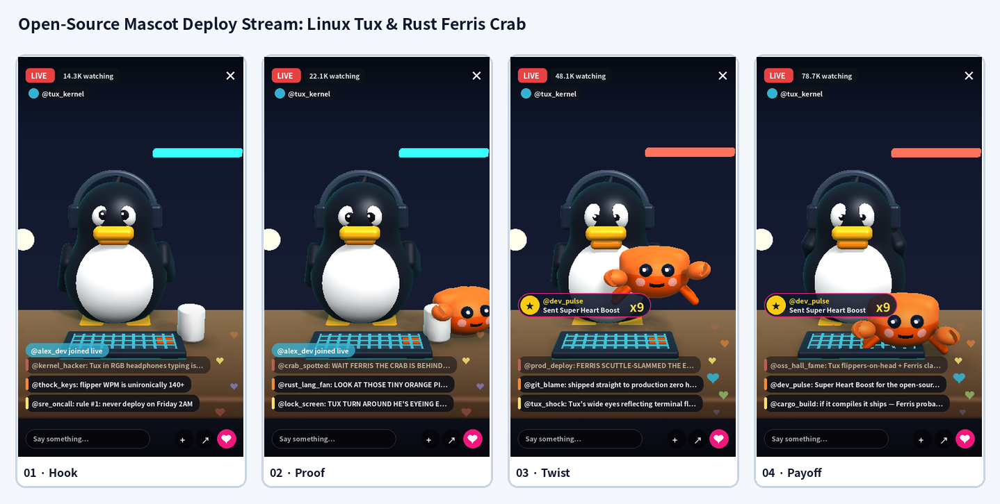</a>
</p>

<p align="center">
  <a href="../../examples/voxel-wuxia-sword-live/">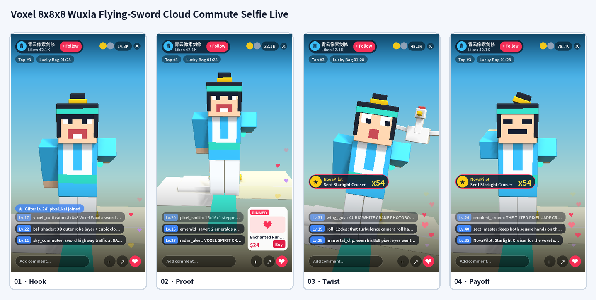</a>
</p>

<p align="center">
  <a href="../../examples/roblox-pet-hatch-pk/">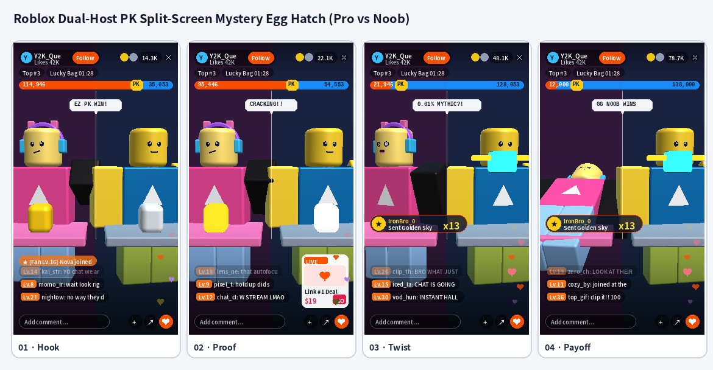</a>
</p>

Cinco interfaces de transmisión reconstruidas mediante REA (`douyin`, `kuaishou`, `instagram`, `x`, `tiktok`, ver [registro REA](../../references/platform-ui-rea-ledger.md)) se superponen tras generar la placa limpia o en vivo desde [`studio/index.html`](../../studio/index.html):

<p align="center">
  
</p>

## Flujo de trabajo e inicio rápido

<p align="center">
  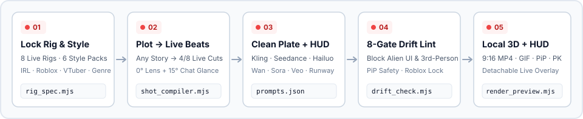
</p>

### Instalar como Agent Skill

Clona este repositorio en la carpeta de skills de tu agente (`~/.codex/skills/livestream-style-video` en Codex, `~/.copilot/skills/livestream-style-video` en GitHub Copilot, o el directorio correspondiente en Claude Code y Cursor):

```bash
git clone https://github.com/yuzhang-zhong/livestream-style-video.git ~/.codex/skills/livestream-style-video
```

Activa `livestream-style-video` en el chat:

```text
Usa $livestream-style-video para adaptar "un caballero medieval haciendo unboxing de una espada encantada frente a la cueva de un dragón cuando el dragón despierta"
en un directo selfie vertical 9:16 de 15 segundos con superposición de compras y combos de Douyin.
Dame el bloqueo de cámara, storyboard de 4 tomas y prompts limpios para Kling / Sora.
```

### Ejecutar las herramientas CLI directamente

Todos los scripts funcionan en Node.js 18+ usando solo la biblioteca estándar (sin `npm install` ni claves API):

```bash
node scripts/render_preview.mjs --spec templates/custom_livestream_spec.json --out-dir out/ramen-live --platform douyin --force
node scripts/shot_compiler.mjs --plot "Un chef de ramen lee el chat en vivo a las 2am cuando la olla se desborda" --platform tiktok --engine kling --lang es
node scripts/drift_check.mjs --pack templates/custom_livestream_spec.json --engine kling --lang es
```

## Scripts, control anti-deriva y referencias

Pedir `"interfaz de directo con comentarios"` directamente al modelo de video genera planos cinematográficos en tercera persona, texto ilegible o dedos humanos en avatares Roblox. `drift_check.mjs` audita 8 compuertas antes de generar:

<p align="center">
  
</p>

| Componente | Salida |
| --- | --- |
| [`SKILL.md`](../../skills/livestream-style-video/SKILL.md) | Punto de entrada principal con los 6 modos de producción y 8 invariantes de transmisión en vivo. |
| [`shot_compiler.mjs`](../../scripts/shot_compiler.mjs) | Compila `--plot`, `--spec` u 8 plantillas en prompts limpios 9:16 de 15s / 30s / 45s y líneas de tiempo HUD. |
| [`rig_spec.mjs`](../../scripts/rig_spec.mjs) | Fija 8 soportes de cámara × 6 estilos visuales y genera la [hoja de referencia en 3 estados](../../assets/showcase/rig_setup_sheet.en.png). |
| [`hud_presets.mjs`](../../scripts/hud_presets.mjs) | Zonas seguras `1080×1920`, estilos de chat, combos de regalos, barras PK y paletas de corazones. |
| [`drift_check.mjs`](../../scripts/drift_check.mjs) | Linter Unicode de 8 compuertas contra deriva cinematográfica, UI corrupta, fusión PiP y errores anatómicos. |
| [`render_preview.mjs`](../../scripts/render_preview.mjs) | Renderizador local 3D + Post-HUD `.mp4` / `.gif` con audio WAV sintetizado. |
| [`studio/index.html`](../../studio/index.html) | Estudio interactivo para navegador / OBS con vista previa `<canvas>` y exportación croma `#00FF00` ([vista](../../assets/showcase/interactive_hud_studio.png)). |

[Cámaras y óptica](../../references/camera-rigs-and-optics.md) · [Matriz de estilos](../../references/style-adapters-matrix.md) · [Trama a pulsos en vivo](../../references/plot-to-livestream-beats.md) · [Registro REA de interfaces](../../references/platform-ui-rea-ledger.md) · [Prompts por modelo](../../references/model-prompt-playbook.md) · [Corrección de deriva](../../references/rescue-and-anti-drift.md) · [8 plantillas](../../references/viral-livestream-archetypes.md)

## Idiomas

Las respuestas del agente y `--lang` en CLI admiten `en`, `zh`, `zh-tw`, `ja`, `ko`, `es`, `fr`, `de`, `pt` y `ru`.

[English](../../README.md) · [简体中文](../../README.zh-CN.md) · [繁體中文](README.zh-TW.md) · [日本語](README.ja.md) · [한국어](README.ko.md) · **Español** · [Français](README.fr.md) · [Deutsch](README.de.md) · [Português](README.pt-BR.md) · [Русский](README.ru.md)

[Licencia MIT](../../LICENSE). Agent Skill independiente de código abierto; no afiliada ni respaldada por ByteDance, Kuaishou, Meta, X Corp. ni Roblox Corporation.
