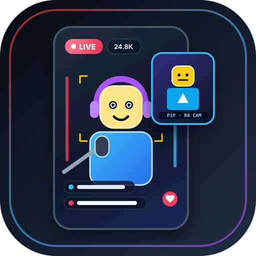
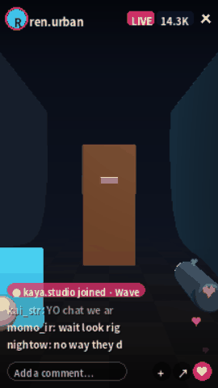

<div align="center">



# Livestream POV Video Skill

Transformez n'importe quel style visuel ou scénario en une véritable perspective de diffusion en direct verticale (`9:16`) : verrouillez les supports de caméra physiques (webcam, perche selfie, caméra embarquée, PiP ou écran partagé PK), compilez des prompts I2V/T2V propres sans texte illisible, et superposez localement les interfaces reconstruites de Douyin, Kuaishou, Instagram Live, X et TikTok.

[](../../SKILL.md)
[](#installation-et-démarrage-rapide)
[](../../LICENSE)

[English](../../README.md) · [简体中文](../../README.zh-CN.md) · [繁體中文](README.zh-TW.md) · [日本語](README.ja.md) · [한국어](README.ko.md) · [Español](README.es.md) · **Français** · [Deutsch](README.de.md) · [Português](README.pt-BR.md) · [Русский](README.ru.md)

</div>

[](../../assets/showcase/livestream_pov_reel.mp4)

## Exemples vidéo (IA générale et Roblox)

Chaque pack découpe l'histoire en quatre temps `9:16` (`0–3.5s` accroche directe, `3.5–7.5s` preuve macro à l'objectif, `7.5–11.5s` imprévu en direct, `11.5–15s` réaction face au chat).

### Échantillons vidéo IA réalistes et multi-genres

| 01 · Selfie Marché de Nuit (`Kling` · Douyin) | 02 · Unboxing Autofocus `[AF-C]` (`Seedance` · Kuaishou) | 03 · Couloir Nocturne POV (`Sora` · IG Live) |
| :---: | :---: | :---: |
| [](../../examples/irl-night-market-selfie/assets/irl_night_market_selfie.mp4) | [](../../examples/desk-unboxing-autofocus/assets/desk_unboxing_autofocus.mp4) | [](../../examples/midnight-corridor-fpv-live/assets/midnight_corridor_fpv_live.mp4) |
| Selfie `18mm` + mise au point `20cm` sur brochette épicée.<br>[MP4](../../examples/irl-night-market-selfie/assets/irl_night_market_selfie.mp4) · [Planche](../../examples/irl-night-market-selfie/assets/storyboard_sheet.en.png) · [Prompts](../../examples/irl-night-market-selfie/) | Caméra bureau `35mm` + geste paume `[AF-C]`.<br>[MP4](../../examples/desk-unboxing-autofocus/assets/desk_unboxing_autofocus.mp4) · [Planche](../../examples/desk-unboxing-autofocus/assets/storyboard_sheet.en.png) · [Prompts](../../examples/desk-unboxing-autofocus/) | Caméra poitrine `16mm` avec téléphone chat et lampe.<br>[MP4](../../examples/midnight-corridor-fpv-live/assets/midnight_corridor_fpv_live.mp4) · [Planche](../../examples/midnight-corridor-fpv-live/assets/storyboard_sheet.en.png) · [Prompts](../../examples/midnight-corridor-fpv-live/) |

| 04 · Webcam Bureau & Chat Roux (`Wan` · X / Periscope) | 05 · Vol sur Épée Wuxia (`Hailuo` · Intrigue Fantastique) |
| :---: | :---: |
| [](../../examples/late-night-study-webcam/assets/late_night_study_webcam.mp4) | [](../../examples/wuxia-sword-flight-live/assets/wuxia_sword_flight_live.mp4) |
| Webcam `24mm` : un chat bondit sur la touche Entrée.<br>[MP4](../../examples/late-night-study-webcam/assets/late_night_study_webcam.mp4) · [Planche](../../examples/late-night-study-webcam/assets/storyboard_sheet.en.png) · [Prompts](../../examples/late-night-study-webcam/) | Adapte un récit fantastique en live selfie `18mm` dans les nuages.<br>[MP4](../../examples/wuxia-sword-flight-live/assets/wuxia_sword_flight_live.mp4) · [Planche](../../examples/wuxia-sword-flight-live/assets/storyboard_sheet.en.png) · [Prompts](../../examples/wuxia-sword-flight-live/) |

### Échantillons livestream style Roblox

| 06 · Sky-Obby + Facecam PiP (`Hailuo` · TikTok) | 07 · Couloir DOORS Selfie (`Sora` · IG Live) | 08 · Duel PK 50/50 (`Kling` · Kuaishou) |
| :---: | | :---: |
| [](../../examples/roblox-obby-rage-pip/assets/roblox_obby_rage_pip.mp4) | [](../../examples/roblox-doors-irl-selfie/assets/roblox_doors_irl_selfie.mp4) | [](../../examples/roblox-pet-hatch-pk/assets/roblox_pet_hatch_pk.mp4) |
| Double piste `R6` + facecam casque RGB.<br>[MP4](../../examples/roblox-obby-rage-pip/assets/roblox_obby_rage_pip.mp4) · [Planche](../../examples/roblox-obby-rage-pip/assets/storyboard_sheet.en.png) · [Prompts](../../examples/roblox-obby-rage-pip/) | Perche selfie `18mm` révélant des yeux blancs derrière l'épaule.<br>[MP4](../../examples/roblox-doors-irl-selfie/assets/roblox_doors_irl_selfie.mp4) · [Planche](../../examples/roblox-doors-irl-selfie/assets/storyboard_sheet.en.png) · [Prompts](../../examples/roblox-doors-irl-selfie/) | Écran partagé `50/50` : Noob obtient un dragon mythique.<br>[MP4](../../examples/roblox-pet-hatch-pk/assets/roblox_pet_hatch_pk.mp4) · [Planche](../../examples/roblox-pet-hatch-pk/assets/storyboard_sheet.en.png) · [Prompts](../../examples/roblox-pet-hatch-pk/) |

## Interfaces et effets reconstruits via REA

La séparation entre image caméra brute et HUD superposé élimine les textes corrompus ([`references/platform-ui-rea-ledger.md`](../../references/platform-ui-rea-ledger.md)) :

<p align="center">
  
</p>

Ouvrez [`studio/index.html`](../../studio/index.html) dans un navigateur ou OBS pour tester les combos cadeaux, cartes shopping, barres PK et fontaines de cœurs :

<p align="center">
  
</p>

## Flux de travail et garde-fous anti-dérive

<p align="center">
  
</p>

<p align="center">
  
</p>

## Installation et démarrage rapide

```bash
git clone https://github.com/yuzhang-zhong/livestream-pov-video.git ~/.copilot/skills/livestream-pov-video
```

Exécution locale avec Node.js 18+ sans dépendances npm :

```bash
node scripts/rig_spec.mjs --rig handheld-selfie-irl --style realistic-irl --host "Lin" --lang fr --out out/rig_card.md
node scripts/shot_compiler.mjs --plot "Un chef de ramen lit le chat en direct à 2h du matin quand le bouillon déborde" --platform tiktok --engine kling --json --out out/ramen_live.json
node scripts/drift_check.mjs --pack out/ramen_live.json --engine kling --lang fr
node scripts/render_preview.mjs --spec out/ramen_live.json --out-dir out/assets --platform tiktok --force
```

## Documentation de référence

- [`SKILL.md`](../../SKILL.md) · [Caméras et optique](../../references/camera-rigs-and-optics.md) · [Matrice des styles](../../references/style-adapters-matrix.md) · [Conversion d'intrigue](../../references/plot-to-livestream-beats.md) · [Registre REA des interfaces](../../references/platform-ui-rea-ledger.md) · [Guide des modèles](../../references/model-prompt-playbook.md) · [Diagnostic anti-dérive](../../references/rescue-and-anti-drift.md)

[Licence MIT](../../LICENSE). Projet open-source indépendant, non affilié à ByteDance, Kuaishou, Meta, X Corp. ou Roblox Corporation.
