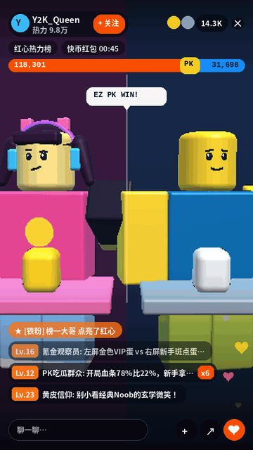
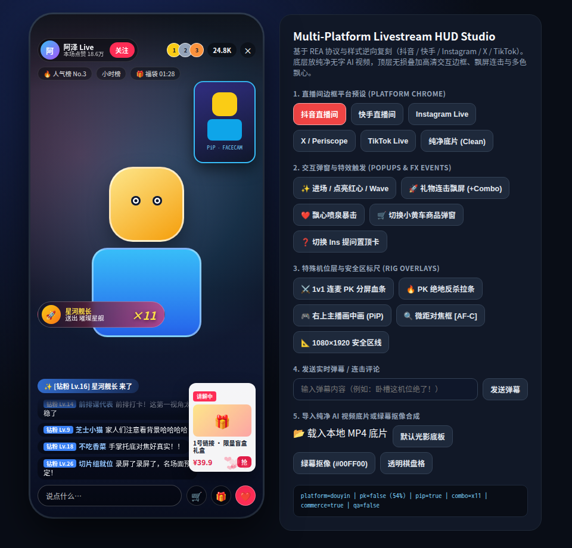

<div align="center">


# Livestream POV Video Skill

あらゆる画風（実写IRL・Roblox R6・アニメVTuber・3Dフィギュア・異世界/時代劇プロット）とストーリーを本格的な **9:16 ライブ配信カメラ視点（POV）** に変換する Agent Skill です。物理カメラ固定、文字化けゼロのクリーンプレート I2V/T2V プロンプト生成、そして REA 解析に基づく Douyin・Kuaishou・Instagram Live・X・TikTok 風配信枠＆エフェクト合成をローカルで完結します。

[](../../SKILL.md)
[](#インストールとクイックスタート)
[](../../LICENSE)

[English](../../README.md) · [简体中文](../../README.zh-CN.md) · [繁體中文](README.zh-TW.md) · **日本語** · [한국어](README.ko.md) · [Español](README.es.md) · [Français](README.fr.md) · [Deutsch](README.de.md) · [Português](README.pt-BR.md) · [Русский](README.ru.md)

</div>

[](../../assets/showcase/livestream_pov_reel.mp4)

## ライブ配信POVサンプル（汎用AI動画 ＆ Roblox）

各サンプルは15秒・4カット構成（`0–3.5s` 開始フック、`3.5–7.5s` 接写AF実証、`7.5–11.5s` 放送事故・急展開、`11.5–15s` コメント欄二度見リアクション）です。

### 汎用実写 ＆ ジャンル変換AI動画サンプル

| 01 · 夜市超広角セルフィー (`Kling` · Douyin枠) | 02 · 卓上AF開封ハプニング (`Seedance` · Kuaishou枠) | 03 · 深夜廊下主観探索 (`Sora` · IG Live枠) |
| :---: | :---: | :---: |
| [](../../examples/irl-night-market-selfie/assets/irl_night_market_selfie.mp4) | [](../../examples/desk-unboxing-autofocus/assets/desk_unboxing_autofocus.mp4) | [](../../examples/midnight-corridor-fpv-live/assets/midnight_corridor_fpv_live.mp4) |
| `18mm` 手持ち自撮り＋激辛串 `20cm` 接写。<br>[MP4](../../examples/irl-night-market-selfie/assets/irl_night_market_selfie.mp4) · [絵コンテ](../../examples/irl-night-market-selfie/assets/storyboard_sheet.en.png) · [プロンプト](../../examples/irl-night-market-selfie/) | `35mm` 左ブームマイク＋手のひら `[AF-C]` フォーカス。<br>[MP4](../../examples/desk-unboxing-autofocus/assets/desk_unboxing_autofocus.mp4) · [絵コンテ](../../examples/desk-unboxing-autofocus/assets/storyboard_sheet.en.png) · [プロンプト](../../examples/desk-unboxing-autofocus/) | `16mm` チェストマウント（左手チャット端末＋右手ライト）。<br>[MP4](../../examples/midnight-corridor-fpv-live/assets/midnight_corridor_fpv_live.mp4) · [絵コンテ](../../examples/midnight-corridor-fpv-live/assets/storyboard_sheet.en.png) · [プロンプト](../../examples/midnight-corridor-fpv-live/) |

| 04 · 深夜作業Webカメラ猫乱入 (`Wan` · X 6色ハート) | 05 · 仙侠・御剣飛行通勤配信 (`Hailuo` · 異世界プロット変換) |
| :---: | :---: |
| [](../../examples/late-night-study-webcam/assets/late_night_study_webcam.mp4) | [](../../examples/wuxia-sword-flight-live/assets/wuxia_sword_flight_live.mp4) |
| `24mm` モニター上部カメラ：茶トラ猫がEnterキーに着地。<br>[MP4](../../examples/late-night-study-webcam/assets/late_night_study_webcam.mp4) · [絵コンテ](../../examples/late-night-study-webcam/assets/storyboard_sheet.en.png) · [プロンプト](../../examples/late-night-study-webcam/) | ファンタジー設定を `18mm` 雲海セルフィー配信へ変換。<br>[MP4](../../examples/wuxia-sword-flight-live/assets/wuxia_sword_flight_live.mp4) · [絵コンテ](../../examples/wuxia-sword-flight-live/assets/storyboard_sheet.en.png) · [プロンプト](../../examples/wuxia-sword-flight-live/) |

### Roblox ブロッキー配信サンプル

| 06 · Obby実況＋右上ワイプ (`Hailuo` · TikTok枠) | 07 · DOORS廊下セルフィー (`Sora` · IG枠) | 08 · 50/50 コラボPK孵化対決 (`Kling` · Kuaishou枠) |
| :---: | :---: | :---: |
| [](../../examples/roblox-obby-rage-pip/assets/roblox_obby_rage_pip.mp4) | [](../../examples/roblox-doors-irl-selfie/assets/roblox_doors_irl_selfie.mp4) | [](../../examples/roblox-pet-hatch-pk/assets/roblox_pet_hatch_pk.mp4) |
| 2トラック合成：`2×2×1` 比率固定＋指なし角柱ハンドで台パン。<br>[MP4](../../examples/roblox-obby-rage-pip/assets/roblox_obby_rage_pip.mp4) · [絵コンテ](../../examples/roblox-obby-rage-pip/assets/storyboard_sheet.en.png) · [プロンプト](../../examples/roblox-obby-rage-pip/) | `18mm` 自撮り棒越しに左肩の背後へ白い目が浮上。<br>[MP4](../../examples/roblox-doors-irl-selfie/assets/roblox_doors_irl_selfie.mp4) · [絵コンテ](../../examples/roblox-doors-irl-selfie/assets/storyboard_sheet.en.png) · [プロンプト](../../examples/roblox-doors-irl-selfie/) | `50/50` 分割コラボPK：初心者Noobが神話ドラゴンを引き逆転。<br>[MP4](../../examples/roblox-pet-hatch-pk/assets/roblox_pet_hatch_pk.mp4) · [絵コンテ](../../examples/roblox-pet-hatch-pk/assets/storyboard_sheet.en.png) · [プロンプト](../../examples/roblox-pet-hatch-pk/) |

## 5大配信プラットフォームUI・ポップアップ・エフェクト再現 (REA)

動画生成AIに直接コメント欄を描かせると文字化けが発生します。本リポジトリはクリーンプレート映像生成と後付けHUD合成を分離し、[`references/platform-ui-rea-ledger.md`](../../references/platform-ui-rea-ledger.md) にてプロトコル・安全領域・REA検証証跡を公開しています。

<p align="center">
  
</p>

ブラウザまたは OBS で [`studio/index.html`](../../studio/index.html) を開くと、任意の `.mp4` にリアルタイムでギフト連撃、ライブコマース枠、PKゲージ、Q&Aカード、ハート噴水を重ねられます：

<p align="center">
  
</p>

## ワークフローとドリフト防止ゲート

<p align="center">
  
</p>

<p align="center">
  
</p>

## インストールとクイックスタート

```bash
git clone https://github.com/yuzhang-zhong/livestream-pov-video.git ~/.copilot/skills/livestream-pov-video
```

Node.js 18+ 標準ライブラリのみでローカル実行可能です：

```bash
node scripts/rig_spec.mjs --rig handheld-selfie-irl --style realistic-irl --host "Lin" --lang ja --out out/rig_card.md
node scripts/shot_compiler.mjs --plot "深夜2時の屋台ラーメン店主がコメントを読んでいる隙にスープが吹きこぼれる" --platform douyin --engine kling --json --out out/ramen_live.json
node scripts/drift_check.mjs --pack out/ramen_live.json --engine kling --lang ja
node scripts/render_preview.mjs --spec out/ramen_live.json --out-dir out/assets --platform douyin --force
```

## リファレンス一覧

- [`SKILL.md`](../../SKILL.md) · [カメラリグ光学仕様](../../references/camera-rigs-and-optics.md) · [スタイル変換マトリクス](../../references/style-adapters-matrix.md) · [プロット変換4幕構成](../../references/plot-to-livestream-beats.md) · [REA 配信UI台帳](../../references/platform-ui-rea-ledger.md) · [モデル別プロンプト集](../../references/model-prompt-playbook.md) · [ドリフト修正ガイド](../../references/rescue-and-anti-drift.md)

[MIT License](../../LICENSE)。独立したオープンソースプロジェクトであり、ByteDance、Kuaishou、Meta、X Corp.、Roblox Corporation とは提携していません。
