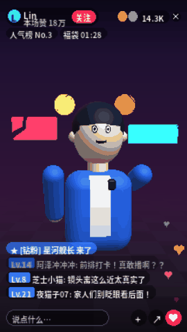
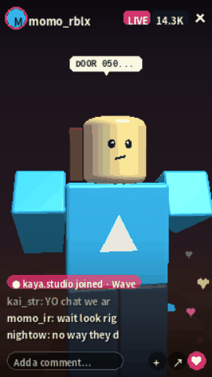

<div align="center">


# Livestream POV Video Skill

어떤 화풍(실사 IRL, Roblox R6 블록, 애니/버튜버, 3D 피규어, 무협/판타지/호러 장르)과 줄거리든 실제 **9:16 라이브 방송 카메라 시점(POV)** 으로 변환하는 Agent Skill입니다. 물리 카메라 마운트 고정, 깨진 글자 없는 클린 플레이트 I2V/T2V 프롬프트 컴파일, 그리고 REA 분석 기반의 도우인·콰이쇼우·인스타그램 라이브·X·틱톡 라이브 오버레이/팝업/하트 이펙트 합성을 로컬에서 지원합니다.

[](../../SKILL.md)
[](#설치-및-빠른-시작)
[](../../LICENSE)

[English](../../README.md) · [简体中文](../../README.zh-CN.md) · [繁體中文](README.zh-TW.md) · [日本語](README.ja.md) · **한국어** · [Español](README.es.md) · [Français](README.fr.md) · [Deutsch](README.de.md) · [Português](README.pt-BR.md) · [Русский](README.ru.md)

</div>

[](../../assets/showcase/livestream_pov_reel.mp4)

## 라이브 시점 샘플 패키지 (일반 AI 비디오 & Roblox)

모든 샘플은 15초·4컷 단일 액션 비트(`0–3.5s` 오프닝 훅, `3.5–7.5s` 근접 초점 검증, `7.5–11.5s` 돌발 방송 사고, `11.5–15s` 채팅창 확인 리액션)로 구성됩니다.

### 일반 실사 및 장르 변환 AI 비디오 샘플

| 01 · 야시장 초광각 셀카 (`Kling` · Douyin HUD) | 02 · 데스크 언박싱 AF 팝업 (`Seedance` · Kuaishou HUD) | 03 · 심야 복도 1인칭 탐색 (`Sora` · IG Live HUD) |
| :---: | :---: | :---: |
| [](../../examples/irl-night-market-selfie/assets/irl_night_market_selfie.mp4) | [](../../examples/desk-unboxing-autofocus/assets/desk_unboxing_autofocus.mp4) | [](../../examples/midnight-corridor-fpv-live/assets/midnight_corridor_fpv_live.mp4) |
| `18mm` 팔 길이 전면 셀카 + 매운 꼬치 `20cm` 접사.<br>[MP4](../../examples/irl-night-market-selfie/assets/irl_night_market_selfie.mp4) · [보드](../../examples/irl-night-market-selfie/assets/storyboard_sheet.en.png) · [프롬프트](../../examples/irl-night-market-selfie/) | `35mm` 좌측 붐 마이크 + 손바닥 `[AF-C]` 초점 전환.<br>[MP4](../../examples/desk-unboxing-autofocus/assets/desk_unboxing_autofocus.mp4) · [보드](../../examples/desk-unboxing-autofocus/assets/storyboard_sheet.en.png) · [프롬프트](../../examples/desk-unboxing-autofocus/) | `16mm` 체스트캠(왼손 채팅폰 + 오른손 손전등).<br>[MP4](../../examples/midnight-corridor-fpv-live/assets/midnight_corridor_fpv_live.mp4) · [보드](../../examples/midnight-corridor-fpv-live/assets/storyboard_sheet.en.png) · [프롬프트](../../examples/midnight-corridor-fpv-live/) |

| 04 · 새벽 작업 웹캠 고양이 난입 (`Wan` · X 6색 하트) | 05 · 무협 어검비행 출근길 (`Hailuo` · 장르 줄거리 변환) |
| :---: | :---: |
| [](../../examples/late-night-study-webcam/assets/late_night_study_webcam.mp4) | [](../../examples/wuxia-sword-flight-live/assets/wuxia_sword_flight_live.mp4) |
| `24mm` 모니터 상단 웹캠: 치즈냥이가 엔터키 점프.<br>[MP4](../../examples/late-night-study-webcam/assets/late_night_study_webcam.mp4) · [보드](../../examples/late-night-study-webcam/assets/storyboard_sheet.en.png) · [프롬프트](../../examples/late-night-study-webcam/) | 판타지/무협 설정을 `18mm` 운해 셀카 방송으로 변환.<br>[MP4](../../examples/wuxia-sword-flight-live/assets/wuxia_sword_flight_live.mp4) · [보드](../../examples/wuxia-sword-flight-live/assets/storyboard_sheet.en.png) · [프롬프트](../../examples/wuxia-sword-flight-live/) |

### Roblox 블록 캐릭터 라이브 샘플

| 06 · 점프맵 + 우상단 캠방 (`Hailuo` · TikTok HUD) | 07 · DOORS 복도 셀카봉 (`Sora` · IG HUD) | 08 · 50/50 합방 PK 알 부화 (`Kling` · Kuaishou HUD) |
| :---: | :---: | :---: |
| [](../../examples/roblox-obby-rage-pip/assets/roblox_obby_rage_pip.mp4) | [](../../examples/roblox-doors-irl-selfie/assets/roblox_doors_irl_selfie.mp4) | [](../../examples/roblox-pet-hatch-pk/assets/roblox_pet_hatch_pk.mp4) |
| A/B 듀얼 트랙 합성: `2×2×1` 비율과 손가락 없는 블록 손.<br>[MP4](../../examples/roblox-obby-rage-pip/assets/roblox_obby_rage_pip.mp4) · [보드](../../examples/roblox-obby-rage-pip/assets/storyboard_sheet.en.png) · [프롬프트](../../examples/roblox-obby-rage-pip/) | `18mm` 셀카봉 화면 너머 왼쪽 어깨 뒤에 하얀 눈 등장.<br>[MP4](../../examples/roblox-doors-irl-selfie/assets/roblox_doors_irl_selfie.mp4) · [보드](../../examples/roblox-doors-irl-selfie/assets/storyboard_sheet.en.png) · [프롬프트](../../examples/roblox-doors-irl-selfie/) | `50/50` 분할 PK: 초보 Noob이 신화 드래곤을 뽑아 역전.<br>[MP4](../../examples/roblox-pet-hatch-pk/assets/roblox_pet_hatch_pk.mp4) · [보드](../../examples/roblox-pet-hatch-pk/assets/storyboard_sheet.en.png) · [프롬프트](../../examples/roblox-pet-hatch-pk/) |

## 5대 라이브 플랫폼 UI · 팝업 · 하트 이펙트 재구성 (REA)

비디오 생성 모델에 직접 채팅창 글자를 그리게 하면 외계어 깨짐 현상이 발생합니다. 본 프로젝트는 **클린 플레이트 영상 생성**과 **후처리 HUD 합성**을 분리하여 정밀한 플랫폼 UI를 제공합니다([`references/platform-ui-rea-ledger.md`](../../references/platform-ui-rea-ledger.md)):

<p align="center">
  
</p>

브라우저나 OBS에서 [`studio/index.html`](../../studio/index.html)을 열어 로컬 `.mp4` 위에 실시간 선물 콤보, 쇼핑 카드, PK 게이지, Q&A 팝업을 테스트할 수 있습니다:

<p align="center">
  
</p>

## 워크플로 및 드리프트 방지

<p align="center">
  
</p>

<p align="center">
  
</p>

## 설치 및 빠른 시작

```bash
git clone https://github.com/yuzhang-zhong/livestream-pov-video.git ~/.copilot/skills/livestream-pov-video
```

Node.js 18+ 표준 라이브러리만으로 CLI 실행:

```bash
node scripts/rig_spec.mjs --rig handheld-selfie-irl --style realistic-irl --host "Lin" --lang ko --out out/rig_card.md
node scripts/shot_compiler.mjs --plot "새벽 2시 포장마차 라멘 요리사가 채팅을 읽다가 육수가 넘치는 방송 사고" --platform douyin --engine kling --json --out out/ramen_live.json
node scripts/drift_check.mjs --pack out/ramen_live.json --engine kling --lang ko
node scripts/render_preview.mjs --spec out/ramen_live.json --out-dir out/assets --platform douyin --force
```

## 레퍼런스 가이드

- [`SKILL.md`](../../SKILL.md) · [카메라 리그 광학](../../references/camera-rigs-and-optics.md) · [화풍 어댑터 매트릭스](../../references/style-adapters-matrix.md) · [줄거리→라이브 4막 변환](../../references/plot-to-livestream-beats.md) · [REA 플랫폼 UI 원장](../../references/platform-ui-rea-ledger.md) · [모델별 프롬프트 가이드](../../references/model-prompt-playbook.md) · [드리프트 복구 가이드](../../references/rescue-and-anti-drift.md)

[MIT License](../../LICENSE). 독립 오픈소스 프로젝트이며 ByteDance, Kuaishou, Meta, X Corp., Roblox Corporation과 무관합니다.
