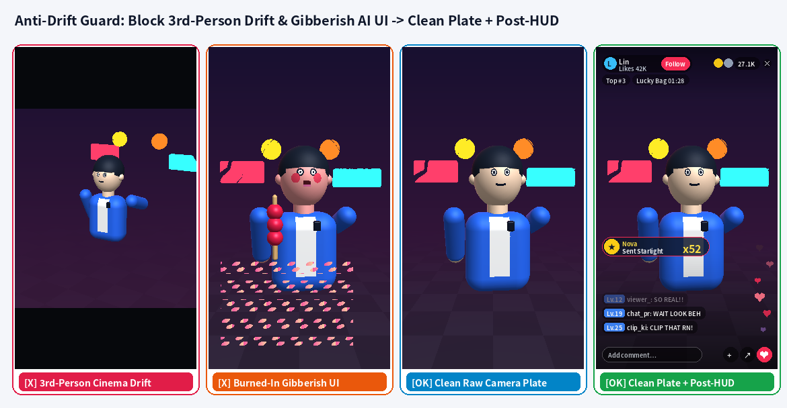

<div align="center">


# Livestream POV Video Skill

Transforme qualquer estilo visual ou enredo em uma perspectiva autêntica de transmissão ao vivo vertical (`9:16`): trave suportes físicos de câmera (webcam, selfie ultra-wide, POV no peito, PiP ou tela dividida PK), compile prompts I2V/T2V limpos sem texto embaralhado e sobreponha interfaces reconstruídas do Douyin, Kuaishou, Instagram Live, X e TikTok localmente.

[](../../SKILL.md)
[](#instalação-e-início-rápido)
[](../../LICENSE)

[English](../../README.md) · [简体中文](../../README.zh-CN.md) · [繁體中文](README.zh-TW.md) · [日本語](README.ja.md) · [한국어](README.ko.md) · [Español](README.es.md) · [Français](README.fr.md) · [Deutsch](README.de.md) · **Português** · [Русский](README.ru.md)

</div>

[](../../assets/showcase/livestream_pov_reel.mp4)

## Exemplos em vídeo (IA geral e Roblox)

Cada pacote divide a história em quatro batidas `9:16` (`0–3.5s` gancho ao vivo, `3.5–7.5s` prova macro na lente, `7.5–11.5s` imprevisto ao vivo e `11.5–15s` reação ao chat).

### Amostras realistas e adaptação de gêneros

| 01 · Selfie na Feira Noturna (`Kling` · Douyin) | 02 · Unboxing com Autofoco `[AF-C]` (`Seedance` · Kuaishou) | 03 · Corredor à Meia-Noite POV (`Sora` · IG Live) |
| :---: | :---: | :---: |
| [](../../examples/irl-night-market-selfie/assets/irl_night_market_selfie.mp4) | [](../../examples/desk-unboxing-autofocus/assets/desk_unboxing_autofocus.mp4) | [](../../examples/midnight-corridor-fpv-live/assets/midnight_corridor_fpv_live.mp4) |
| Selfie `18mm` + foco macro `20cm` no espeto apimentado.<br>[MP4](../../examples/irl-night-market-selfie/assets/irl_night_market_selfie.mp4) · [Prancha](../../examples/irl-night-market-selfie/assets/storyboard_sheet.en.png) · [Prompts](../../examples/irl-night-market-selfie/) | Câmera fixa `35mm` + gesto de palma `[AF-C]`.<br>[MP4](../../examples/desk-unboxing-autofocus/assets/desk_unboxing_autofocus.mp4) · [Prancha](../../examples/desk-unboxing-autofocus/assets/storyboard_sheet.en.png) · [Prompts](../../examples/desk-unboxing-autofocus/) | Câmera peitoral `16mm` com celular de chat e lanterna.<br>[MP4](../../examples/midnight-corridor-fpv-live/assets/midnight_corridor_fpv_live.mp4) · [Prancha](../../examples/midnight-corridor-fpv-live/assets/storyboard_sheet.en.png) · [Prompts](../../examples/midnight-corridor-fpv-live/) |

| 04 · Webcam de Estudo e Gato (`Wan` · X / Periscope) | 05 · Voo na Espada Wuxia (`Hailuo` · Fantasia ao Vivo) |
| :---: | :---: |
| [](../../examples/late-night-study-webcam/assets/late_night_study_webcam.mp4) | [](../../examples/wuxia-sword-flight-live/assets/wuxia_sword_flight_live.mp4) |
| Webcam `24mm`: gato laranja pula na tecla Enter.<br>[MP4](../../examples/late-night-study-webcam/assets/late_night_study_webcam.mp4) · [Prancha](../../examples/late-night-study-webcam/assets/storyboard_sheet.en.png) · [Prompts](../../examples/late-night-study-webcam/) | Adapta fantasia épica para uma live selfie `18mm` nas nuvens.<br>[MP4](../../examples/wuxia-sword-flight-live/assets/wuxia_sword_flight_live.mp4) · [Prancha](../../examples/wuxia-sword-flight-live/assets/storyboard_sheet.en.png) · [Prompts](../../examples/wuxia-sword-flight-live/) |

### Amostras de live estilo Roblox

| 06 · Sky-Obby + Facecam PiP (`Hailuo` · TikTok) | 07 · Corredor DOORS Selfie (`Sora` · IG Live) | 08 · Duelo PK 50/50 (`Kling` · Kuaishou) |
| :---: | :---: | :---: |
| [](../../examples/roblox-obby-rage-pip/assets/roblox_obby_rage_pip.mp4) | [](../../examples/roblox-doors-irl-selfie/assets/roblox_doors_irl_selfie.mp4) | [](../../examples/roblox-pet-hatch-pk/assets/roblox_pet_hatch_pk.mp4) |
| Pista dupla `R6` + facecam RGB sincronizada.<br>[MP4](../../examples/roblox-obby-rage-pip/assets/roblox_obby_rage_pip.mp4) · [Prancha](../../examples/roblox-obby-rage-pip/assets/storyboard_sheet.en.png) · [Prompts](../../examples/roblox-obby-rage-pip/) | Bastão selfie `18mm` captura olhos brilhantes atrás do ombro.<br>[MP4](../../examples/roblox-doors-irl-selfie/assets/roblox_doors_irl_selfie.mp4) · [Prancha](../../examples/roblox-doors-irl-selfie/assets/storyboard_sheet.en.png) · [Prompts](../../examples/roblox-doors-irl-selfie/) | Tela dividida `50/50`: Noob choca um dragão mítico e vira o PK.<br>[MP4](../../examples/roblox-pet-hatch-pk/assets/roblox_pet_hatch_pk.mp4) · [Prancha](../../examples/roblox-pet-hatch-pk/assets/storyboard_sheet.en.png) · [Prompts](../../examples/roblox-pet-hatch-pk/) |

## Interfaces e efeitos reconstruídos com REA

Separar o vídeo limpo da câmera do HUD pós-composto evita texto corrompido nos modelos de difusão ([`references/platform-ui-rea-ledger.md`](../../references/platform-ui-rea-ledger.md)):

<p align="center">
  
</p>

Abra [`studio/index.html`](../../studio/index.html) no navegador ou OBS para acionar combos de presentes, cards de compra, barras PK e fontes de corações sobre qualquer `.mp4`:

<p align="center">
  
</p>

## Fluxo de trabalho e verificação anti-desvio

<p align="center">
  
</p>

<p align="center">
  
</p>

## Instalação e início rápido

```bash
git clone https://github.com/yuzhang-zhong/livestream-pov-video.git ~/.copilot/skills/livestream-pov-video
```

Uso direto via CLI em Node.js 18+ sem dependências externas:

```bash
node scripts/rig_spec.mjs --rig handheld-selfie-irl --style realistic-irl --host "Lin" --lang pt --out out/rig_card.md
node scripts/shot_compiler.mjs --plot "Chef de lámen lê o chat ao vivo às 2h da manhã quando a panela transborda" --platform tiktok --engine kling --json --out out/ramen_live.json
node scripts/drift_check.mjs --pack out/ramen_live.json --engine kling --lang pt
node scripts/render_preview.mjs --spec out/ramen_live.json --out-dir out/assets --platform tiktok --force
```

## Guias de referência

- [`SKILL.md`](../../SKILL.md) · [Câmeras e óptica](../../references/camera-rigs-and-optics.md) · [Matriz de estilos](../../references/style-adapters-matrix.md) · [Enredo para batidas ao vivo](../../references/plot-to-livestream-beats.md) · [Registro REA de UI](../../references/platform-ui-rea-ledger.md) · [Prompts por modelo](../../references/model-prompt-playbook.md) · [Guia anti-desvio](../../references/rescue-and-anti-drift.md)

[Licença MIT](../../LICENSE). Projeto independente de código aberto; sem afiliação com ByteDance, Kuaishou, Meta, X Corp. ou Roblox Corporation.
