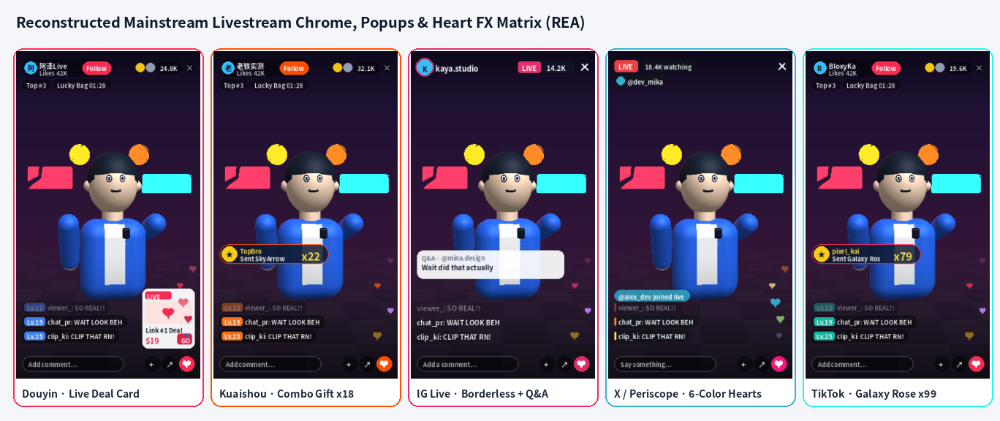

<div align="center">


# Livestream POV Video Skill

Превращает любой визуальный стиль и сюжет в аутентичный вертикальный ракурс прямой трансляции (`9:16`): фиксирует физические крепления камеры (веб-камера, селфи-монопод, нагрудная экшн-камера, PiP или 50/50 PK-сплит), компилирует чистые I2V/T2V-промпты без искажённого текста и накладывает реконструированные интерфейсы Douyin, Kuaishou, Instagram Live, X и TikTok локально.

[](../../SKILL.md)
[](#установка-и-быстрый-старт)
[](../../LICENSE)

[English](../../README.md) · [简体中文](../../README.zh-CN.md) · [繁體中文](README.zh-TW.md) · [日本語](README.ja.md) · [한국어](README.ko.md) · [Español](README.es.md) · [Français](README.fr.md) · [Deutsch](README.de.md) · [Português](README.pt-BR.md) · **Русский**

</div>

[](../../assets/showcase/livestream_pov_reel.mp4)

## Примеры видео (универсальное ИИ-видео и Roblox)

Каждый пакет разбивает сюжет на четыре одноактовых бита `9:16` (`0–3.5s` хук в эфире, `3.5–7.5s` макро-проверка у объектива, `7.5–11.5s` внезапный поворот в прямом эфире и `11.5–15s` реакция на чат).

### Реалистичные и кросс-жанровые примеры

| 01 · Селфи на ночном рынке (`Kling` · Douyin) | 02 · Распаковка с автофокусом `[AF-C]` (`Seedance` · Kuaishou) | 03 · Ночной коридор от первого лица (`Sora` · IG Live) |
| :---: | :---: | :---: |
| [](../../examples/irl-night-market-selfie/assets/irl_night_market_selfie.mp4) | [](../../examples/desk-unboxing-autofocus/assets/desk_unboxing_autofocus.mp4) | [](../../examples/midnight-corridor-fpv-live/assets/midnight_corridor_fpv_live.mp4) |
| Селфи `18mm` + макрофокус `20cm` на острой шпажке.<br>[MP4](../../examples/irl-night-market-selfie/assets/irl_night_market_selfie.mp4) · [Лист](../../examples/irl-night-market-selfie/assets/storyboard_sheet.en.png) · [Промпты](../../examples/irl-night-market-selfie/) | Настольная камера `35mm` + жест ладони `[AF-C]`.<br>[MP4](../../examples/desk-unboxing-autofocus/assets/desk_unboxing_autofocus.mp4) · [Лист](../../examples/desk-unboxing-autofocus/assets/storyboard_sheet.en.png) · [Промпты](../../examples/desk-unboxing-autofocus/) | Нагрудная камера `16mm` со смартфоном чата и фонарём.<br>[MP4](../../examples/midnight-corridor-fpv-live/assets/midnight_corridor_fpv_live.mp4) · [Лист](../../examples/midnight-corridor-fpv-live/assets/storyboard_sheet.en.png) · [Промпты](../../examples/midnight-corridor-fpv-live/) |

| 04 · Ночная веб-камера и кот (`Wan` · X / Periscope) | 05 · Полёт на мече уся (`Hailuo` · Жанровая адаптация) |
| :---: | :---: |
| [](../../examples/late-night-study-webcam/assets/late_night_study_webcam.mp4) | [](../../examples/wuxia-sword-flight-live/assets/wuxia_sword_flight_live.mp4) |
| Веб-камера `24mm`: рыжий кот прыгает на клавишу Enter.<br>[MP4](../../examples/late-night-study-webcam/assets/late_night_study_webcam.mp4) · [Лист](../../examples/late-night-study-webcam/assets/storyboard_sheet.en.png) · [Промпты](../../examples/late-night-study-webcam/) | Перевод фэнтези-сюжета в `18mm` селфи-стрим над облаками.<br>[MP4](../../examples/wuxia-sword-flight-live/assets/wuxia_sword_flight_live.mp4) · [Лист](../../examples/wuxia-sword-flight-live/assets/storyboard_sheet.en.png) · [Промпты](../../examples/wuxia-sword-flight-live/) |

### Примеры стримов в стиле Roblox

| 06 · Sky-Obby + PiP-вебка (`Hailuo` · TikTok) | 07 · Коридор DOORS селфи (`Sora` · IG Live) | 08 · Совместный PK-баттл 50/50 (`Kling` · Kuaishou) |
| :---: | :---: | :---: |
| [](../../examples/roblox-obby-rage-pip/assets/roblox_obby_rage_pip.mp4) | [](../../examples/roblox-doors-irl-selfie/assets/roblox_doors_irl_selfie.mp4) | [](../../examples/roblox-pet-hatch-pk/assets/roblox_pet_hatch_pk.mp4) |
| Двухдорожечный композит `R6` + реакция в углу.<br>[MP4](../../examples/roblox-obby-rage-pip/assets/roblox_obby_rage_pip.mp4) · [Лист](../../examples/roblox-obby-rage-pip/assets/storyboard_sheet.en.png) · [Промпты](../../examples/roblox-obby-rage-pip/) | Селфи-палка `18mm` ловит светящиеся глаза за плечом.<br>[MP4](../../examples/roblox-doors-irl-selfie/assets/roblox_doors_irl_selfie.mp4) · [Лист](../../examples/roblox-doors-irl-selfie/assets/storyboard_sheet.en.png) · [Промпты](../../examples/roblox-doors-irl-selfie/) | Разделённый экран `50/50`: Noob выбивает мифического дракона.<br>[MP4](../../examples/roblox-pet-hatch-pk/assets/roblox_pet_hatch_pk.mp4) · [Лист](../../examples/roblox-pet-hatch-pk/assets/storyboard_sheet.en.png) · [Промпты](../../examples/roblox-pet-hatch-pk/) |

## Реконструкция интерфейсов и эффектов платформ (REA)

Разделение чистого кадра камеры и постобработки HUD полностью устраняет искажённые символы в видеомоделях ([`references/platform-ui-rea-ledger.md`](../../references/platform-ui-rea-ledger.md)):

<p align="center">
  
</p>

Откройте [`studio/index.html`](../../studio/index.html) в браузере или OBS, чтобы накладывать комбо подарков, карточки товаров, полосы PK и фонтаны сердечек на любой `.mp4`:

<p align="center">
  
</p>

## Пайплайн и защита от дрейфа стиля

<p align="center">
  
</p>

<p align="center">
  
</p>

## Установка и быстрый старт

```bash
git clone https://github.com/yuzhang-zhong/livestream-pov-video.git ~/.copilot/skills/livestream-pov-video
```

Запуск CLI на Node.js 18+ без внешних npm-зависимостей:

```bash
node scripts/rig_spec.mjs --rig handheld-selfie-irl --style realistic-irl --host "Lin" --lang ru --out out/rig_card.md
node scripts/shot_compiler.mjs --plot "Повар ночной раменной читает чат стрима в 2 часа ночи, когда бульон убегает" --platform tiktok --engine kling --json --out out/ramen_live.json
node scripts/drift_check.mjs --pack out/ramen_live.json --engine kling --lang ru
node scripts/render_preview.mjs --spec out/ramen_live.json --out-dir out/assets --platform tiktok --force
```

## Справочные материалы

- [`SKILL.md`](../../SKILL.md) · [Камеры и оптика](../../references/camera-rigs-and-optics.md) · [Матрица стилей](../../references/style-adapters-matrix.md) · [Перевод сюжета в эфир](../../references/plot-to-livestream-beats.md) · [Реестр REA по UI](../../references/platform-ui-rea-ledger.md) · [Промпты по моделям](../../references/model-prompt-playbook.md) · [Анти-дрейф руководство](../../references/rescue-and-anti-drift.md)

[Лицензия MIT](../../LICENSE). Независимый open-source проект, не связанный с ByteDance, Kuaishou, Meta, X Corp. или Roblox Corporation.
