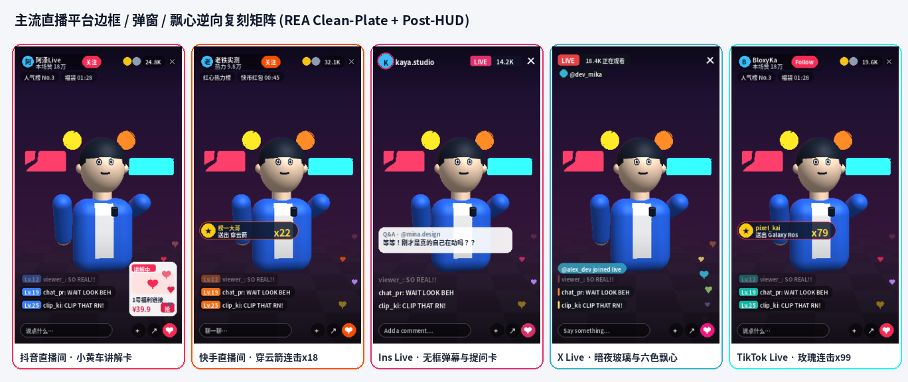
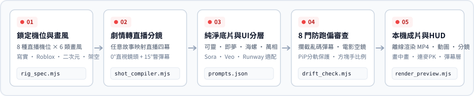
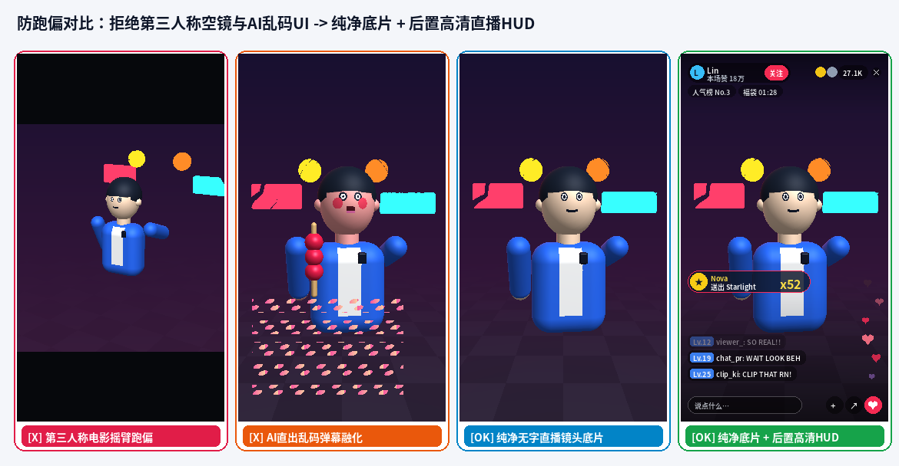

<div align="center">


# Livestream POV Video Skill

將任意畫風與任意劇情轉譯為真實的 9:16 直播間視角：鎖定手持自拍桿、桌面攝影機、第一人稱雙持、畫中畫與連麥 PK 機位，編譯零亂碼的純淨 AI 影片底片提示詞，並在本機無損疊加復刻版抖音、快手、Instagram Live、X 與 TikTok 直播邊框、彈窗與飄心特效。

[](../../SKILL.md)
[](#安裝與快速上手)
[](../../LICENSE)

[English](../../README.md) · [简体中文](../../README.zh-CN.md) · **繁體中文** · [日本語](README.ja.md) · [한국어](README.ko.md) · [Español](README.es.md) · [Français](README.fr.md) · [Deutsch](README.de.md) · [Português](README.pt-BR.md) · [Русский](README.ru.md)

</div>

[](../../assets/showcase/livestream_pov_reel.mp4)

## 直播視角短片樣本

每支樣本將故事拆解為 15 秒、4 個單動作直播節拍（`0–3.5s` 開播立 Flag、`3.5–7.5s` 懟臉對焦實測、`7.5–11.5s` 直播突發反轉、`11.5–15s` 掃彈幕破防定格）。點擊任意動圖可開啟含合成現場音效的 H.264 MP4。

### 通用寫實與跨題材 AI 影片樣本

| 01 · 夜市超廣角自拍試吃 (`可靈` · 抖音邊框) | 02 · 桌面微距對焦開箱彈飛 (`即夢` · 快手邊框) | 03 · 深夜舊樓第一人稱探險 (`Sora` · Ins 邊框) |
| :---: | :---: | :---: |
| [](../../examples/irl-night-market-selfie/assets/irl_night_market_selfie.mp4) | [](../../examples/desk-unboxing-autofocus/assets/desk_unboxing_autofocus.mp4) | [](../../examples/midnight-corridor-fpv-live/assets/midnight_corridor_fpv_live.mp4) |
| `18mm` 一臂前置跟走 + `20cm` 烤串微距對焦。<br>[MP4](../../examples/irl-night-market-selfie/assets/irl_night_market_selfie.mp4) · [分鏡表](../../examples/irl-night-market-selfie/assets/storyboard_sheet.zh.png) · [提示詞包](../../examples/irl-night-market-selfie/) | `35mm` 左置懸臂麥 + 手掌托底 `[AF-C]` 對焦。<br>[MP4](../../examples/desk-unboxing-autofocus/assets/desk_unboxing_autofocus.mp4) · [分鏡表](../../examples/desk-unboxing-autofocus/assets/storyboard_sheet.zh.png) · [提示詞包](../../examples/desk-unboxing-autofocus/) | `16mm` 胸掛雙持（左手副機看彈幕 + 右手手電筒）。<br>[MP4](../../examples/midnight-corridor-fpv-live/assets/midnight_corridor_fpv_live.mp4) · [分鏡表](../../examples/midnight-corridor-fpv-live/assets/storyboard_sheet.zh.png) · [提示詞包](../../examples/midnight-corridor-fpv-live/) |

| 04 · 深夜趕工橘貓踩鍵盤 (`萬相` · X 多色飄心) | 05 · 仙俠御劍早高峰通勤 (`海螺` · 架空劇情轉直播) |
| :---: | :---: |
| [](../../examples/late-night-study-webcam/assets/late_night_study_webcam.mp4) | [](../../examples/wuxia-sword-flight-live/assets/wuxia_sword_flight_live.mp4) |
| `24mm` 螢幕頂端攝影機：橘貓飛撲踩下 Enter。<br>[MP4](../../examples/late-night-study-webcam/assets/late_night_study_webcam.mp4) · [分鏡表](../../examples/late-night-study-webcam/assets/storyboard_sheet.zh.png) · [提示詞包](../../examples/late-night-study-webcam/) | 示範如何將奇幻仙俠劇情轉譯為 `18mm` 雲海自拍直播。<br>[MP4](../../examples/wuxia-sword-flight-live/assets/wuxia_sword_flight_live.mp4) · [分鏡表](../../examples/wuxia-sword-flight-live/assets/storyboard_sheet.zh.png) · [提示詞包](../../examples/wuxia-sword-flight-live/) |

### Roblox 方塊小人直播視角樣本

| 06 · 天空跑酷 + 右上反應小窗 (`海螺` · TikTok) | 07 · DOORS 走廊自拍桿突臉 (`Sora` · Ins) | 08 · 雙人連麥 PK 抽蛋反殺 (`可靈` · 快手) |
| :---: | :---: | :---: |
| [](../../examples/roblox-obby-rage-pip/assets/roblox_obby_rage_pip.mp4) | [](../../examples/roblox-doors-irl-selfie/assets/roblox_doors_irl_selfie.mp4) | [](../../examples/roblox-pet-hatch-pk/assets/roblox_pet_hatch_pk.mp4) |
| A/B 雙軌獨立合成：鎖定 `2×2×1` 比例與無手指實心方手。<br>[MP4](../../examples/roblox-obby-rage-pip/assets/roblox_obby_rage_pip.mp4) · [分鏡表](../../examples/roblox-obby-rage-pip/assets/storyboard_sheet.zh.png) · [提示詞包](../../examples/roblox-obby-rage-pip/) | `18mm` 自拍桿前置縱深拍到左肩後方發光白眼。<br>[MP4](../../examples/roblox-doors-irl-selfie/assets/roblox_doors_irl_selfie.mp4) · [分鏡表](../../examples/roblox-doors-irl-selfie/assets/storyboard_sheet.zh.png) · [提示詞包](../../examples/roblox-doors-irl-selfie/) | `50/50` 對稱連麥分屏：新手孵出方塊神龍瞬間反殺 PK 條。<br>[MP4](../../examples/roblox-pet-hatch-pk/assets/roblox_pet_hatch_pk.mp4) · [分鏡表](../../examples/roblox-pet-hatch-pk/assets/storyboard_sheet.zh.png) · [提示詞包](../../examples/roblox-pet-hatch-pk/) |

## 主流直播間介面與特效逆向復刻 (REA)

直接讓擴散模型生成彈幕文字會產生嚴重亂碼。本專案透過 **REA (`reverse-engineer-anything`)** 協議與樣式分析，將**純淨鏡頭底片**與**後置高清直播 HUD** 分離（詳見 [`references/platform-ui-rea-ledger.md`](../../references/platform-ui-rea-ledger.md)）：

<p align="center">
  
</p>

可直接用瀏覽器或 OBS 開啟 [`studio/index.html`](../../studio/index.html) 載入任意 `.mp4` 底片並觸發禮物連擊、小黃車、連麥 PK 與六色飄心：

<p align="center">
  
</p>

## 五步工作流與防跑偏檢查

<p align="center">
  
</p>

<p align="center">
  
</p>

## 安裝與快速上手

```bash
git clone https://github.com/yuzhang-zhong/livestream-pov-video.git ~/.copilot/skills/livestream-pov-video
```

直接執行內建零依賴命令列腳本：

```bash
node scripts/rig_spec.mjs --rig handheld-selfie-irl --style realistic-irl --host "阿澤" --lang zh-tw --out out/rig_card.md
node scripts/shot_compiler.mjs --plot "拉麵攤主深夜看彈幕時湯鍋突然撲鍋" --platform douyin --engine kling --json --out out/ramen_live.json
node scripts/drift_check.mjs --pack out/ramen_live.json --engine kling --lang zh-tw
node scripts/render_preview.mjs --spec out/ramen_live.json --out-dir out/assets --platform douyin --force
```

## 核心組件與文件索引

| 組件 | 說明 |
| --- | --- |
| [`SKILL.md`](../../SKILL.md) | 定義 8 大直播視角鐵律與 6 種工作模式。 |
| [`scripts/rig_spec.mjs`](../../scripts/rig_spec.mjs) | 鎖定機位焦段、`0°/15°` 眼神軸與[直播間三態參考卡](../../assets/showcase/rig_setup_sheet.zh.png)。 |
| [`scripts/shot_compiler.mjs`](../../scripts/shot_compiler.mjs) | 支援 `--plot` 任意劇情轉譯、8 套模板與多模型提示詞編譯。 |
| [`scripts/drift_check.mjs`](../../scripts/drift_check.mjs) | 8 門防跑偏檢查器，攔截電影空鏡、亂碼 UI 與 Roblox 五指串味。 |
| [`scripts/render_preview.mjs`](../../scripts/render_preview.mjs) | 本機 3D 直播場景 + 多平台 HUD 合成渲染引擎。 |
| [`studio/index.html`](../../studio/index.html) | 互動式瀏覽器 / OBS 直播邊框與特效疊加工作台。 |

[機位與光學](../../references/camera-rigs-and-optics.md) · [跨畫風矩陣](../../references/style-adapters-matrix.md) · [劇情轉直播節奏](../../references/plot-to-livestream-beats.md) · [REA 介面逆向台帳](../../references/platform-ui-rea-ledger.md) · [模型提示詞手冊](../../references/model-prompt-playbook.md) · [防跑偏救場指南](../../references/rescue-and-anti-drift.md)

[MIT 授權條款](../../LICENSE)。獨立開源專案，與字節跳動、快手、Meta、X Corp. 或 Roblox Corporation 無隸屬或背書關係。
