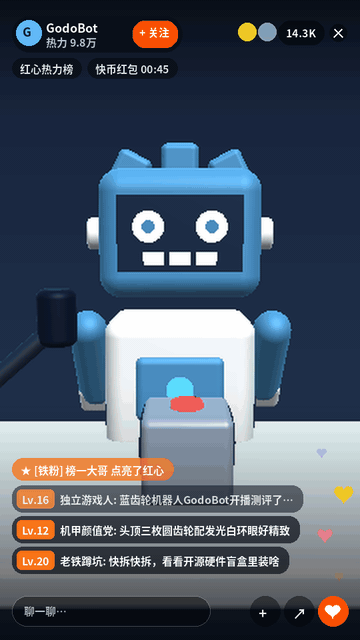
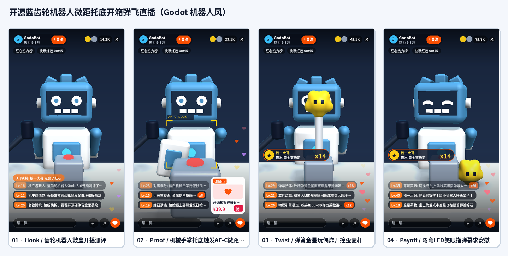

# 04 · Open-Source Blue Gear-Bot [AF-C] Mystery Box Unboxing Live / 开源蓝齿轮机器人微距托底开箱弹飞直播（Godot 机器人风）

15-second (`9:16`, 4-shot) **Livestream POV** package compiled with `--template godot-bot-unboxing-af --engine seedance --platform kuaishou`.

| 9:16 Animated Preview (Post-HUD) | 4-Shot Storyboard Contact Sheet |
| :---: | :---: |
| <a href="assets/godot_bot_unboxing_af.mp4"></a> |  |

## Package contents

- [`assets/godot_bot_unboxing_af.mp4`](assets/godot_bot_unboxing_af.mp4): offline 720p `9:16` preview video (`H.264 MP4 + synthesized live audio + kuaishou HUD`)
- [`assets/storyboard_sheet.zh.png`](assets/storyboard_sheet.zh.png) · [`en`](assets/storyboard_sheet.en.png): Chinese and English HD 4-shot contact sheets
- [`rig_card.md`](rig_card.md): Camera Rig (`overhead-showcase-rig`) + Style (`opensource-mascot`) DNA card and 3-state setup anchor prompt
- [`storyboard.md`](storyboard.md) · [`prompts.json`](prompts.json): Clean-Plate first-frame & `seedance` motion prompts + Post-HUD popup timeline
- [`drift_report.md`](drift_report.md): 8-gate anti-drift verification report (**PASS**)

## Reproduce

```bash
node scripts/rig_spec.mjs --rig overhead-showcase-rig --style opensource-mascot --host "GodoBot" --lang zh-en --out examples/godot-bot-unboxing-af/rig_card.md
node scripts/shot_compiler.mjs --template godot-bot-unboxing-af --duration 15 --engine seedance --platform kuaishou --lang zh-en --out examples/godot-bot-unboxing-af/storyboard.md
node scripts/shot_compiler.mjs --template godot-bot-unboxing-af --duration 15 --engine seedance --platform kuaishou --json --out examples/godot-bot-unboxing-af/prompts.json
node scripts/drift_check.mjs --pack examples/godot-bot-unboxing-af/prompts.json --engine seedance --lang zh-en --out examples/godot-bot-unboxing-af/drift_report.md
```
